Total cache size: GPU 上的 KV cache 和 embedding cache 总量固定为 16 / 32 / 64 GiB。

Workload: 取 KuaiRand-27K 前半段，序列末尾 100 个 video 当作候选，再往前当作历史 his = 1k。因此 KV 全部命中时所需要的 cache size = 48.72 GiB，embedding 全部命中时所需要的 cache size = 3.08 GiB。
Model: `kuairand_1k_inference_ranking.gin`：N = 3，H = 4，d = 128，d_h = 512，s = 1024，t = 2048，c = 100。

Cache ratio: 0.05 - 0.95, 步长 = 0.05

# Overall

从实验结果来看，将结果分为下面三类：

1. [KV 占主导](#sec-kv)：KV 的收益 > embedding 的收益，如 embedding table 位于 CPU。
2. [embedding 占主导](#sec-emb)：embedding 的收益 > KV 的收益，如 embedding table 位于 Redis。
3. [模拟实验](#sec-sim)：让 KV 的代价和 embedding 的代价沿 cache ratio 变化是同样量级。

# 一、KV 占主导

## Phase1: KV miss uses recompute，embedding miss use CPU parameter table.

embedding 走 CPU 参数表。一次请求 KV 未命中是重算，命中是从 GPU 读：

$$
L_{\mathrm{miss}}-L_{\mathrm{hit}}=0.060-0.00788=0.052\ \mathrm{ms}
$$

一个 embedding id 未命中走 PCIe，命中走 GPU：

$$
L_{\mathrm{miss}}-L_{\mathrm{hit}}=0.0325-0.00128=0.031\ \mu\mathrm{s}
$$

cache ratio 每变化一格 \(\Delta f\)，延迟变化是这个差乘上这一格命中（或 miss 个数）的变化：

$$
\begin{aligned}
\Delta L_{\mathrm{kv}}(f)&=(L_{\mathrm{miss}}-L_{\mathrm{hit}})\,\Delta h(f)\\
\Delta L_{\mathrm{emb}}(f)&=(L_{\mathrm{miss}}-L_{\mathrm{hit}})\,\Delta m(f)
\end{aligned}
$$

KV miss 直接在 GPU 上重算。embedding miss 进 CPU 参数表。这一节是情形1：跳变后一次 embedding miss 只有 0.031 µs，KV 仍主导，最低在最右。

每张图的左轴是平均延迟，右轴是命中率。蓝线是 GPU KV token 命中率。橙线是 embedding 命中率。

对于 KV 而言，未命中是重算，命中是从 GPU 读 KV。

### Total Cache size = 16 GiB

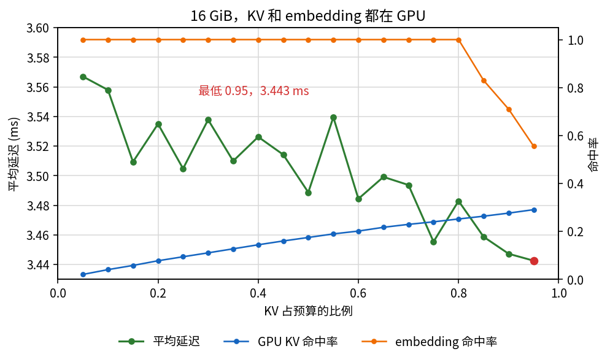

平均延迟随着 KV cache ratio 的增加而呈下降趋势。当 KV 比例 ≤ 0.80 时，embedding cache ≥ 16 × (1 − 0.80) = 3.20 GiB，embedding 命中率是 1。

因此，当 KV cache ratio < 0.80 时，embedding 的 hit rate = 1，latency 只和 KV 有关，随着 KV cache 增大，latency 逐渐减小。

当 KV cache ratio > 0.80 时，embedding hit rate < 1（KV cache ratio = 0.85、0.90、0.95 降到 0.830、0.710、0.555）。一次 embedding miss 只有 0.031 µs，远小于 KV 命中省下的 0.31 ms。因此随着 KV cache ratio 增大，latency 降低。

### Total Cache size = 32 GiB

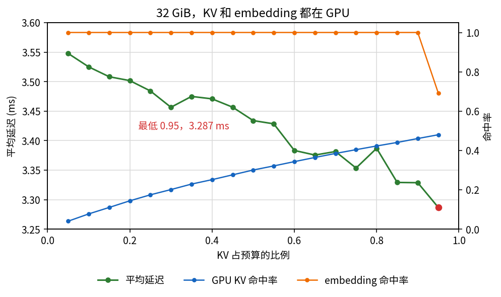

平均延迟随着 KV cache ratio 的增加而呈下降趋势。当 KV 比例 ≤ 0.90 时，embedding cache ≥ 32 × (1 − 0.90) = 3.20 GiB，embedding 命中率是 1。

因此，当 KV cache ratio < 0.90 时，embedding 的 hit rate = 1，latency 只和 KV 有关，随着 KV cache 增大，latency 逐渐减小。

当 KV cache ratio > 0.90 时，只有 0.95 这一格，embedding hit rate 降到 0.691。一次 embedding miss 只有 0.031 µs，小于 KV 命中省下的 0.51 ms。

### Total Cache size = 64 GiB

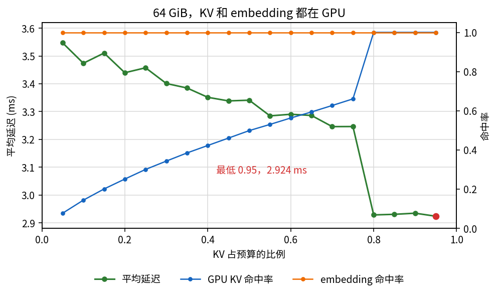

首先 KV cache ratio 从 0.05 - 0.95，embedding cache > 3.2GiB, embedding 是一定命中。当 KV cache ratio > 0.8 时，KV 开始全部命中。
因此，平均延迟随着 KV cache ratio 的增加而下降，KV 全中之后逐渐平缓。

# Phase2: KVCache and embedding cache in GPU，KV miss first CPU load and recompute，embedding miss use CPU parameter table.

GPU 上 KV 和 embedding 按比例划分。另外加一块固定的 32 GiB CPU KV cache (CPU hit rate： ～0.4)。KV 先查 GPU，没有再查这块 CPU cache，两边都没有才重算。embedding miss 进 CPU 参数表。这一节的特征是情形1：跳变后 KV 收益大于 embedding，延迟继续下降。

图的左轴仍是平均延迟，右轴是 GPU KV token 命中率和 embedding 命中率。

对于 KV 而言，三条路径是

$$
\begin{aligned}
L_{\mathrm{GPU}} &= 7.88\ \mu\mathrm{s} \\
L_{\mathrm{CPU}} &= 0.208\ \mathrm{ms} \\
L_{\mathrm{recompute}} &= 0.060\ \mathrm{ms}
\end{aligned}
$$

两两相减：

$$
\begin{aligned}
L_{\mathrm{CPU}}-L_{\mathrm{GPU}} &= 0.208-0.00788=0.200\ \mathrm{ms} \\
L_{\mathrm{recompute}}-L_{\mathrm{GPU}} &= 0.060-0.00788=0.052\ \mathrm{ms} \\
L_{\mathrm{recompute}}-L_{\mathrm{CPU}} &= 0.060-0.208=-0.148\ \mathrm{ms}
\end{aligned}
$$

第三行里 miss 是重算，hit 是 CPU 命中，所以 $L_{\mathrm{miss}}-L_{\mathrm{hit}}$ 是负的。CPU 命中最慢，GPU 命中最快，重算在中间。

对于 embedding 而言，一个 id 未命中走 PCIe，命中走 GPU。

$$
L_{\mathrm{miss}}-L_{\mathrm{hit}}=0.031\ \mu\mathrm{s}
$$

## Total Cache size = 16 GiB

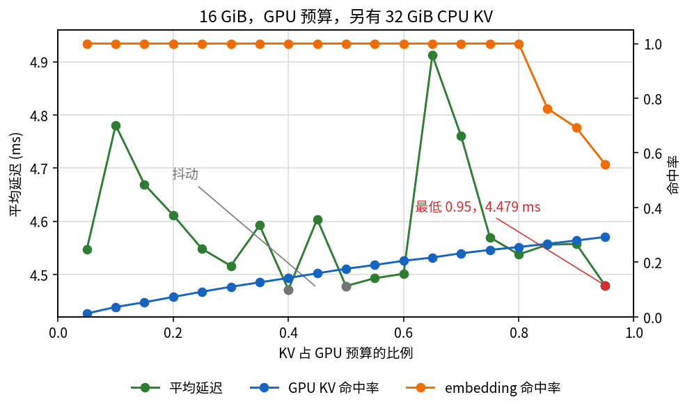

当 KV 比例 ≤ 0.80 时，embedding cache ≥ 16 × (1 − 0.80) = 3.20 GiB，命中率是 1。GPU KV 最大 12.80 GiB，小于 48.72 GiB，没有 KV 全部在 GPU 命中。
KV cache ratio = 0.05 时：GPU 命中 0.012，CPU 命中 0.430，重算 0.558。
KV cache ratio = 0.80：GPU 命中 0.256，CPU 命中 0.200，重算 0.544。

因此，随着 KV Cache ratio 的增加，GPU 命中率增加，GPU latency < CPU latency，因此平均延迟下降。

当 KV 比例 > 0.80 时，embedding hit rate 降到 0.559。随着 KV Cache ratio 的增加，GPU 命中率增加，embedding hit rate 下降，但是 KV cache 收益 > embedding 收益，所以 latency 同样下降。0.40 的 4.471 ms 和 0.50 的 4.478 ms 是抖动。最低在 0.95，4.479 ms。

## Total Cache size = 32 GiB

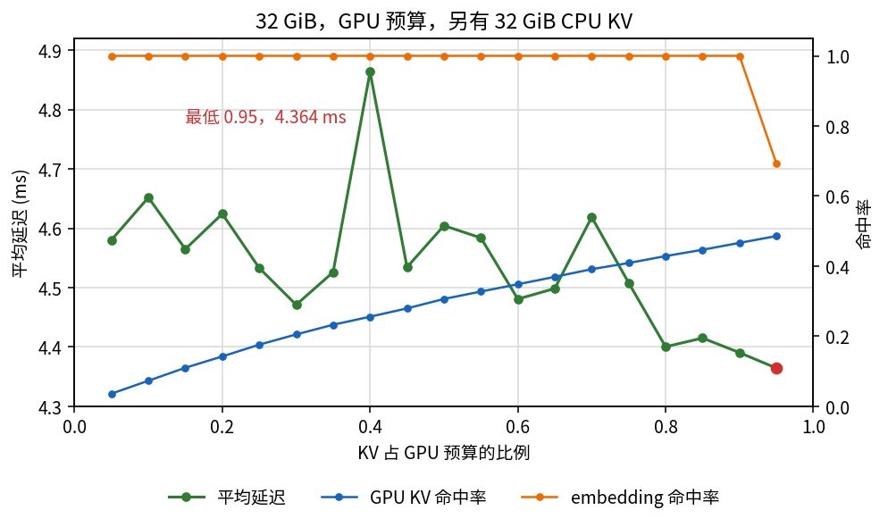

当 KV 比例 ≤ 0.90 时，embedding cache ≥ 32 × (1 − 0.90) = 3.20 GiB，命中率是 1。GPU KV 最大 28.80 GiB，小于 48.72 GiB，没有 KV 全部在 GPU 命中。
KV cache ratio = 0.05 时：GPU 命中 0.036，CPU 命中 0.415，重算 0.549。
KV cache ratio = 0.90：GPU 命中 0.466，CPU 命中 0.027，重算 0.507。

因此，随着 KV Cache ratio 的增加，GPU 命中率增加，GPU latency < CPU latency，因此平均延迟下降。

当 KV 比例 > 0.90 时，只有 0.95 这一格，embedding hit rate 降到 0.692。随着 KV Cache ratio 的增加，GPU 命中率增加，embedding hit rate 下降，但是 KV cache 收益 > embedding 收益，所以 latency 同样下降。

## Total Cache size = 64 GiB

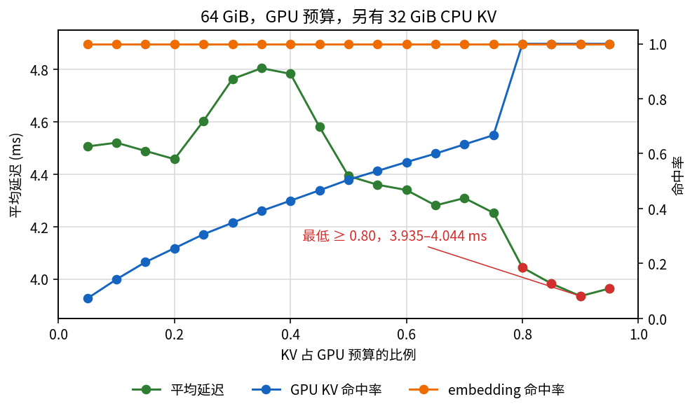

当 KV 比例 ≤ 0.95 时，embedding cache ≥ 64 × (1 − 0.95) = 3.20 GiB，命中率是 1。KV 全部在 GPU 命中从比例 0.80 开始，GPU KV = 51.20 GiB，大于 48.72 GiB。
KV cache ratio = 0.05 时：GPU 命中 0.073，CPU 命中 0.378，重算 0.549。
KV cache ratio = 0.80：GPU 命中 1，CPU 命中 0，重算 0。

因此，随着 KV Cache ratio 的增加，GPU 命中率增加，GPU latency < CPU latency，因此平均延迟下降。比例 ≥ 0.80 的 0.80、0.85、0.90、0.95 都是最低这一档，延迟在 3.935–4.044 ms。KV 已经全部在 GPU 命中，embedding hit rate 仍是 1。

# 二、embedding 占主导

embedding 走 Redis 时，一条请求的 miss 是一次 MGET，大约 30 µs + 0.87 µs × m。只拿 0.89 µs/id 去和 KV 的 0.052 ms 比，会觉得还是 KV 占主导。跳变后一格 miss 就是大约一百到三百个 id，乘上个数之后 embedding 才比 KV 大，延迟从角点往上走。

## Phase3: KV miss uses recompute，embedding miss use Redis.

KV miss 直接在 GPU 上重算。embedding miss 进本机 Redis。

每张图的左轴是平均延迟，右轴是命中率。绿线是粗扫实测，浅绿三角是细扫实测，灰虚线是理论延迟。蓝线是 GPU KV token 命中率。橙线是 embedding 命中率。红点是最小 / 折中，标在 embedding 还能全中的最后一格（角点）。全中段里的数值最低点是波动，不标。细扫在另一台机器上，绝对延迟有差异，图上把细扫第一格平移到粗扫跳变点。

对于 KV 而言，未命中是重算，命中是从 GPU 读 KV。

$$
L_{\mathrm{miss}}-L_{\mathrm{hit}}=0.060-0.00788=0.052\ \mathrm{ms}
$$

对于 embedding 而言，未命中走 Redis。本机 345 个 id 的一次 MGET 再拷到 GPU 是 0.307 ms，合 0.89 µs/id。

$$
L_{\mathrm{miss}}-L_{\mathrm{hit}}=0.89\ \mu\mathrm{s}
$$

0.89 µs 比 0.052 ms 小大约 60 倍，按 per-id 看会以为 KV 仍主导。cache ratio 每动一格要比的是：

$$
\begin{aligned}
\Delta L_{\mathrm{kv}}(f)&=0.052\ \mathrm{ms}\times\Delta h(f)\\
\Delta L_{\mathrm{emb}}(f)&=0.030\ \mathrm{ms}+0.89\ \mu\mathrm{s}\times\Delta m(f)
\end{aligned}
$$

\(\Delta m\) 是每条请求 miss 的 video id 个数，跳变后大约 90–350。16 GiB 从 0.80 到 0.85，\(\Delta h \approx 0.011\)，KV 只省 0.0006 ms；\(\Delta m = 136\)，Redis 大约 0.15 ms。所以跳变后是 embedding 主导，折中在角点。灰线和实测升高一致。

### Total Cache size = 16 GiB

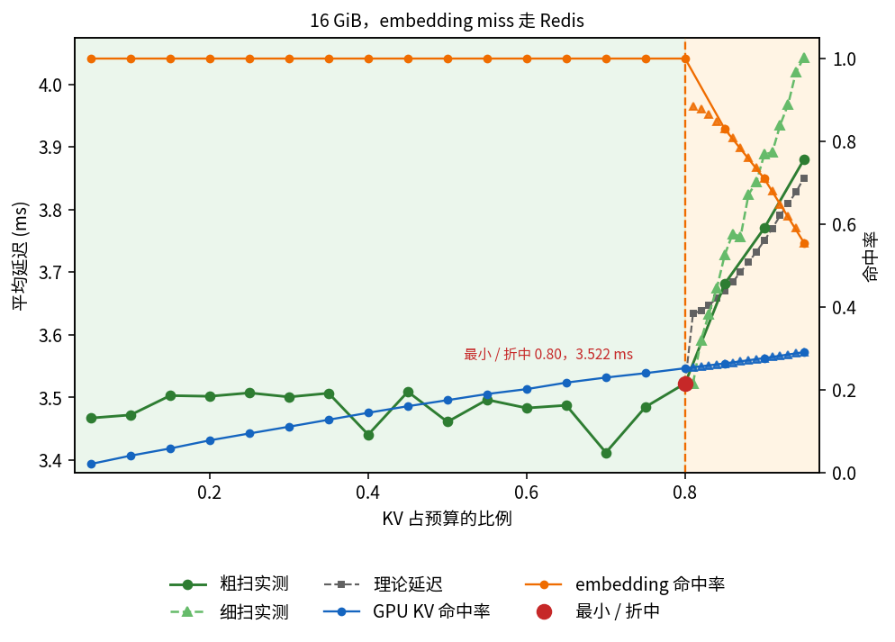

当 KV 比例 ≤ 0.80 时，embedding cache ≥ 16 × (1 − 0.80) = 3.20 GiB，命中率是 1，miss 个数是 0。0.05 到 0.80 平均延迟 3.412–3.522 ms，是波动。

跳变点在 0.80。之后命中率和每条请求 miss 的 video id 个数：

- 0.80：命中率 1，miss 0
- 0.81（细扫第一格）：命中率 0.884，miss 约 94
- 0.85：命中率 0.830，miss 约 136
- 0.90：命中率 0.710，miss 约 229
- 0.95：命中率 0.555，miss 约 345

miss 个数大约 90–350。粗扫从 0.80 的 3.522 ms 升到 0.85、0.90、0.95 的 3.682、3.771、3.880 ms，升高 0.160、0.249、0.358 ms。理论取数 0.15、0.23、0.33 ms，和粗扫同一档。细扫在另一台机器上，绝对延迟从 0.81 的 3.969 ms 升到 0.95 的 4.489 ms，叠在同一张图上，格子更密，仍然只升不降，没有内部凹点。红点最小 / 折中在 0.80，3.522 ms。

### Total Cache size = 32 GiB

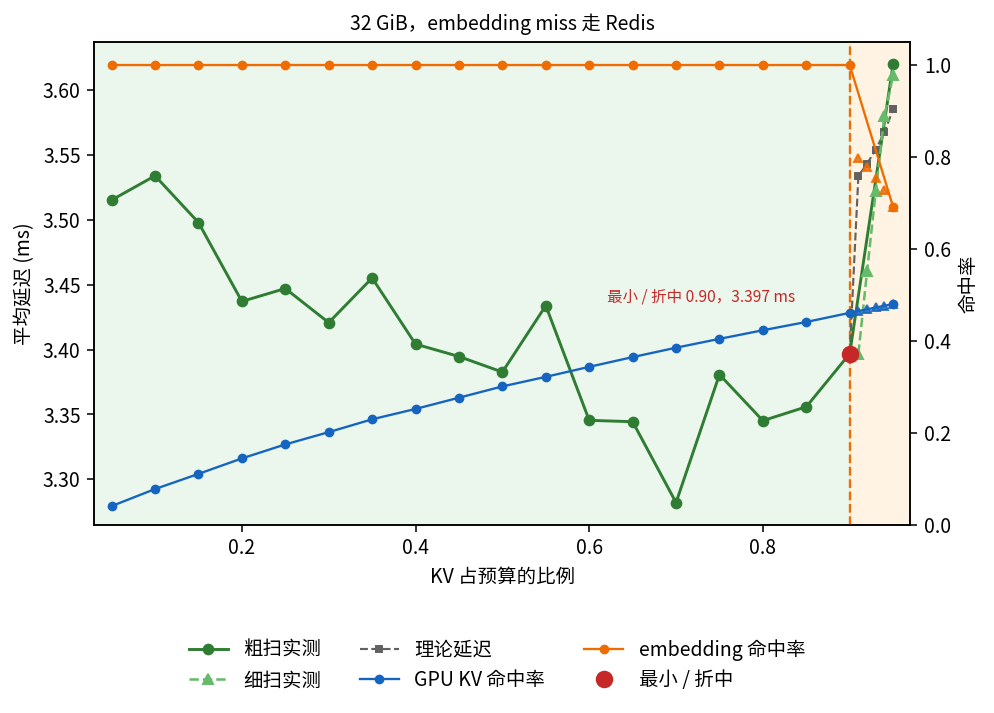

当 KV 比例 ≤ 0.90 时，embedding cache ≥ 32 × (1 − 0.90) = 3.20 GiB，命中率是 1，miss 个数是 0。这一段是波动，不标最低点。

跳变点在 0.90。之后：

- 0.90：命中率 1，miss 0
- 0.91（细扫第一格）：命中率 0.797，miss 约 123
- 0.95：命中率 0.691，miss 约 184

miss 个数大约 120–180。粗扫从 0.90 的 3.397 ms 升到 0.95 的 3.620 ms，升高 0.223 ms，理论取数 0.19 ms。细扫在另一台机器上，绝对延迟从 0.91 的 3.901 ms 升到 0.95 的 4.116 ms，叠在同一张图上，只升不降。红点最小 / 折中在 0.90，3.397 ms。

### Total Cache size = 64 GiB

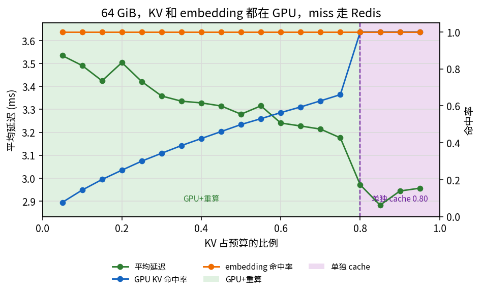

KV 比例从 0.05 到 0.95，embedding cache ≥ 3.20 GiB，命中率是 1，请求没有进 Redis，没有跳变点。0.80 之前是 GPU+重算。KV 全部命中从比例 0.80 开始，GPU KV = 51.20 GiB，大于 48.72 GiB，这一段是单独 cache。

因此，平均延迟随着 KV cache ratio 的增加而下降，KV 全中之后走平。0.80、0.85、0.90、0.95 的延迟是 2.971、2.883、2.944、2.956 ms，差 0.06–0.09 ms。

## Phase4: 1K，KV 加 32 GiB CPU cache，embedding miss 走 Redis.

这一节是历史上限 1024 的 1K 流量。GPU 上 KV 和 embedding 按比例划分，另外加一块固定的 32 GiB CPU KV。KV 先查 GPU，没有再查这块 CPU cache，两边都没有才重算。embedding miss 进本机 Redis。这一节的特征是情形2：跳变后 Redis 取数压过 KV，折中是角点。

图的左轴是平均延迟，右轴是 GPU KV token 命中率和 embedding 命中率。底色按 KV 路径分段。橙色虚线标在 embedding 命中率最后一次等于 1 的格子，作为跳变点。

对于 KV 而言，三条路径是

$$
\begin{aligned}
L_{\mathrm{GPU}} &= 7.88\ \mu\mathrm{s} \\
L_{\mathrm{CPU}} &= 0.208\ \mathrm{ms} \\
L_{\mathrm{recompute}} &= 0.060\ \mathrm{ms}
\end{aligned}
$$

$$
\begin{aligned}
L_{\mathrm{CPU}}-L_{\mathrm{GPU}} &= 0.200\ \mathrm{ms} \\
L_{\mathrm{recompute}}-L_{\mathrm{GPU}} &= 0.052\ \mathrm{ms} \\
L_{\mathrm{recompute}}-L_{\mathrm{CPU}} &= -0.148\ \mathrm{ms}
\end{aligned}
$$

对于 embedding 而言，没有 miss 的取数时间是 0，一条请求有 m 个 miss 是 30 µs + 0.87 µs × m。

## Total Cache size = 16 GiB

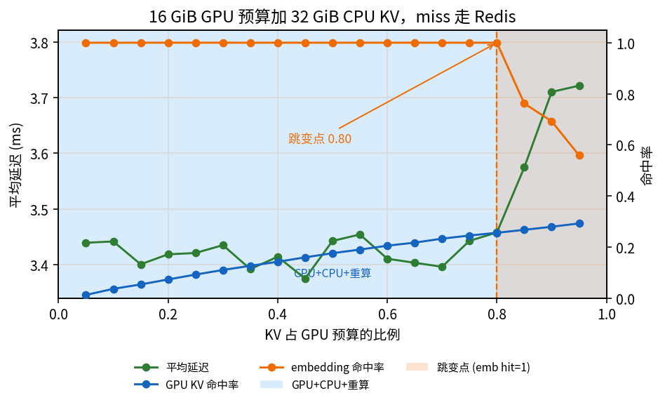

当 KV 比例 ≤ 0.80 时，embedding cache ≥ 16 × (1 − 0.80) = 3.20 GiB，命中率是 1，embedding miss 时间是 0。GPU KV 最大 12.80 GiB，小于 48.72 GiB，没有 KV 全部在 GPU 命中。
KV cache ratio = 0.05 时：GPU 命中 0.012，CPU 命中 0.430，重算 0.558。
KV cache ratio = 0.80：GPU 命中 0.256，CPU 命中 0.201，重算 0.544。
这一段平均延迟 3.375–3.458 ms，是波动。

跳变点在 0.80，这是 embedding 命中率最后一次等于 1 的格子。之后 0.85、0.90、0.95 降到 0.762、0.692、0.559。每条请求的 miss 是 137、177、254 次，取数时间是 0.134、0.171、0.244 ms。平均延迟从 0.80 的 3.458 ms 升到 0.95 的 3.721 ms，升高 0.263 ms。

### Total Cache size = 32 GiB

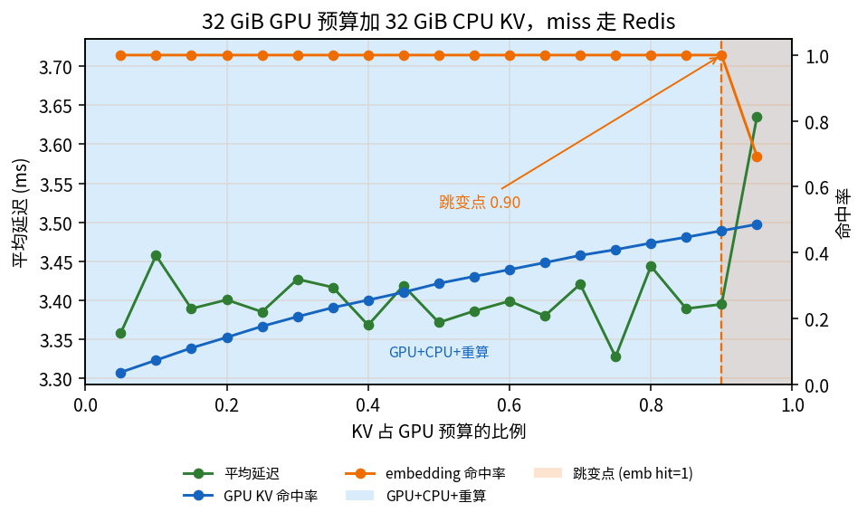

当 KV 比例 ≤ 0.90 时，embedding cache ≥ 32 × (1 − 0.90) = 3.20 GiB，命中率是 1，embedding miss 时间是 0。GPU KV 最大 28.80 GiB，小于 48.72 GiB，没有 KV 全部在 GPU 命中。
KV cache ratio = 0.05 时：GPU 命中 0.036，CPU 命中 0.415，重算 0.549。
KV cache ratio = 0.90：GPU 命中 0.466，CPU 命中 0.027，重算 0.507。
这一段是波动，不标最低点。

跳变点在 0.90，这是 embedding 命中率最后一次等于 1 的格子。之后只有 0.95，命中率 0.692。每条请求 177 次 miss，取数时间 0.171 ms。平均延迟从 0.90 的 3.395 ms 升到 3.635 ms，升高 0.240 ms。

### Total Cache size = 64 GiB

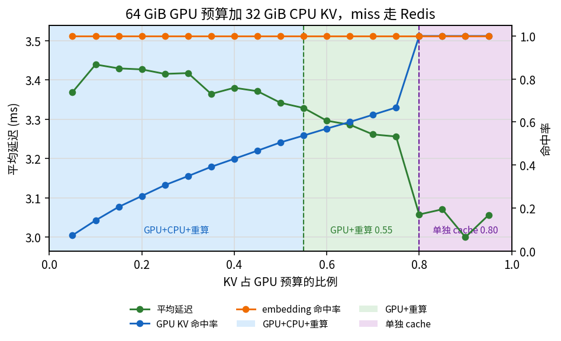

KV 比例从 0.05 到 0.95，embedding cache ≥ 3.20 GiB，命中率是 1，embedding miss 时间是 0，没有跳变点。0.55 之前是 GPU+CPU+重算，0.55 到 0.80 是 GPU+重算（CPU 独占命中已经是 0）。KV 全部在 GPU 命中从比例 0.80 开始，GPU KV = 51.20 GiB，大于 48.72 GiB，这一段是单独 cache。
KV cache ratio = 0.05 时：GPU 命中 0.073，CPU 命中 0.378，重算 0.549。
KV cache ratio = 0.80：GPU 命中 1，CPU 命中 0，重算 0。

因此，随着 KV cache ratio 的增加，GPU 命中从 CPU 命中里换出来，平均延迟下降。KV 全中之后走平。0.80、0.85、0.90、0.95 是 3.058、3.071、3.000、3.056 ms。

## Phase3-H4K: his = 4096，KV miss uses recompute，embedding miss use Redis.

GPU 上 KV 和 embedding 按比例划分，没有额外的 CPU KV。同一份 KuaiRand-27K 前半段，历史上限 4096。KV 工作集是 146.44 GiB，embedding 全部命中要 6.75 GiB。KV miss 在 GPU 上重算。embedding miss 进本机 Redis。图上橙色虚线标在 embedding 命中率最后一次等于 1 的格子，作为跳变点。

没有 miss 的取数时间是 0，有 m 个 miss 是 30 µs + 0.87 µs × m。

### Total Cache size = 16 GiB

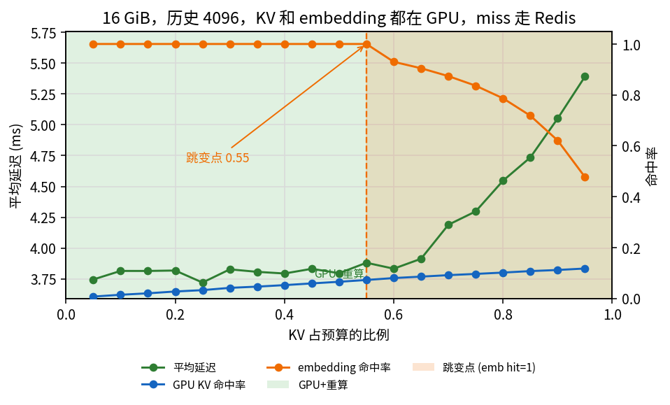

当 KV 比例 ≤ 0.55 时，embedding cache ≥ 16 × (1 − 0.55) = 7.20 GiB，命中率是 1。0.05 到 0.55 的 miss 时间都是 0。GPU KV 最大 15.20 GiB，小于 146.44 GiB，请求命中从 0.008 升到 0.074。平均延迟 3.720–3.881 ms，是波动。

跳变点在 0.55，这是 embedding 命中率最后一次等于 1 的格子。之后 0.60 到 0.95 降到 0.930、0.905、0.874、0.836、0.787、0.718、0.621、0.477。每条请求的 miss 是 191、258、340、439、569、746、999、1369 次，取数时间是 0.177、0.238、0.312、0.401、0.516、0.673、0.895、1.219 ms。0.60 的平均延迟 3.833 ms 仍在全中段的抖动里；从 0.70 的 4.189 ms 升到 0.95 的 5.391 ms。0.95 的 GPU KV token 命中是 0.118。

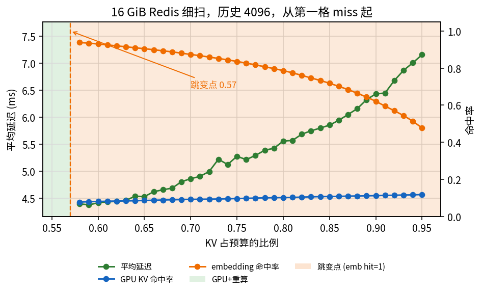

跳变点在 0.57。0.58 是 4.397 ms，0.95 是 7.153 ms。0.59 比 0.58 低 0.018 ms，是抖动。格子更密，仍然没有内部凹点。

### Total Cache size = 32 GiB

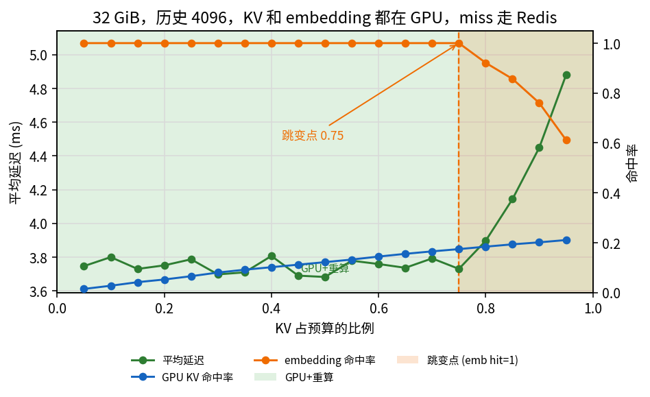

当 KV 比例 ≤ 0.75 时，embedding cache ≥ 32 × (1 − 0.75) = 8.00 GiB，命中率是 1。0.05 到 0.75 的 miss 时间都是 0。GPU KV 最大 24.00 GiB，小于 146.44 GiB，请求命中从 0.015 升到 0.178。平均延迟 3.682–3.807 ms，是波动。

跳变点在 0.75，这是 embedding 命中率最后一次等于 1 的格子。之后 0.80 到 0.95 降到 0.921、0.857、0.760、0.612。每条请求的 miss 是 192、344、570、912 次，取数时间是 0.178、0.316、0.518、0.819 ms。平均延迟从 0.75 的 3.730 ms 升到 3.897、4.143、4.448、4.879 ms。0.95 的 GPU KV token 命中是 0.210。

### Total Cache size = 64 GiB

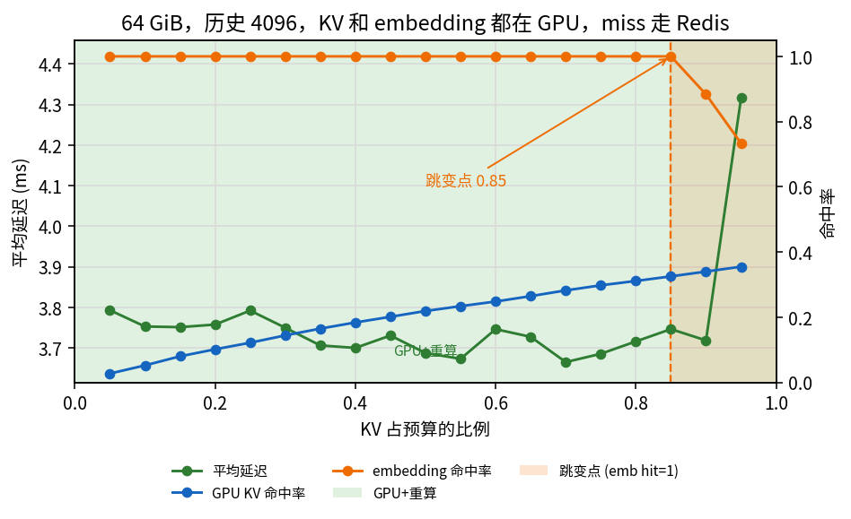

当 KV 比例 ≤ 0.85 时，embedding cache ≥ 64 × (1 − 0.85) = 9.60 GiB，命中率是 1。0.05 到 0.85 的 miss 时间都是 0。GPU KV 最大 54.40 GiB，小于 146.44 GiB，没有 KV 全部命中。请求命中从 0.029 升到 0.331。平均延迟 3.665–3.793 ms，是波动。

跳变点在 0.85，这是 embedding 命中率最后一次等于 1 的格子。之后 0.90 的命中率是 0.883，每条请求 231 次 miss，取数时间 0.215 ms，平均延迟 3.719 ms，还在全中段的抖动里。0.95 降到 0.733，517 次 miss，取数时间 0.470 ms，平均延迟从 0.85 的 3.746 ms 升到 4.316 ms。0.95 的 GPU KV token 命中是 0.355。

# 三、模拟实验：两边权衡

前面两节的流量是预热和计时同一条：8000 用户，历史上限 1024，Zipf seed=1，计时是预热的第二遍。embedding 在跳变前全中，miss 是断崖，折中只能钉在角点。

这一节换了 benchmark 流量。用户池改成全量合格用户，历史上限 4096，26000 条。预热 seed=1，计时 seed=2，两条流的 id 不完全重合。计时里有一批预热没见过的 id，左边 15.20 GiB 也装不下并集，所以 embedding 从第一格就不是全中，没有命中率等于 1 的跳变点。KV 工作集大约 697 GiB，命中只随比例慢慢爬。CPU 参数表上两边沿 cache ratio 的代价同量级，折中可以落在中间。延迟差只有几微秒，纵轴要收到 4.24–4.28 ms 才能看见。

# Phase7: 双流，KV miss uses recompute，embedding miss use CPU parameter table.（情形3）

历史上限 4096，全量用户，预热 seed=1 / 计时 seed=2，26000 条，16 GiB。GPU 上 KV 和 embedding 按比例划分。KV miss 在 GPU 上重算。embedding miss 进 CPU 参数表，没有额外等待。

图的左轴是平均延迟，右轴是命中率。蓝线是 GPU KV token 命中率。橙线是 embedding 命中率。灰虚线是理论延迟，把第一格对齐到 GPU 均值，只保留随比例的变化：

$$
L(f)=0.515\,(1-h(f))\ \mathrm{ms}+0.031\ \mu\mathrm{s}\times m(f)
$$

红点是折中，标法和前面几节的最低点一样。

$$
\begin{aligned}
\Delta L_{\mathrm{kv}}(f)&=0.515\,\Delta h(f)\ \mathrm{ms}\\
\Delta L_{\mathrm{emb}}(f)&=0.031\ \mu\mathrm{s}\times\Delta m(f)
\end{aligned}
$$

KV 命中从 0.17% 升到 4.0%，每格 \(\Delta h \approx 0.002\)。embedding 命中从 0.97 降到 0.47，每格 \(\Delta m\) 从 13 涨到 391。公式在 0.45 打平，凹深 0.004 ms。

## Total Cache size = 16 GiB

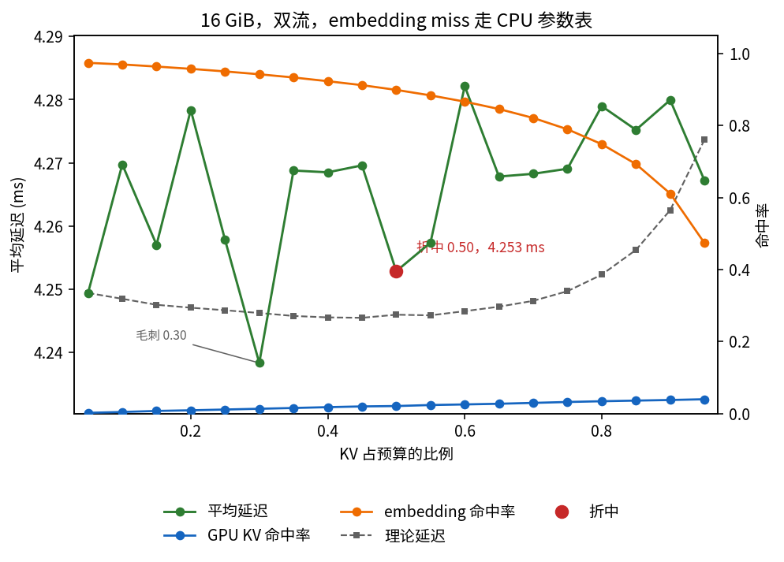

平均延迟在 4.238–4.282 ms。纵轴只画这一截，中间的起伏才能看见。

0.30 的 4.238 ms 是数值最低，但按理论延迟，这一格掉到灰线下面 0.008 ms，理论在这里仍应缓缓下降、还没到凹点，所以看成毛刺，不认为是 trade off。

灰线以上、又和理论凹点同一带的局部低点在 0.50，4.253 ms，比理论高 0.007 ms。理论本身在 0.45 打平。红点折中标在 0.50。

# Phase7-wait: 双流，KV miss 空等 14 ms，embedding miss 0.931 µs/id.

同一条双流，16 GiB。上一节凹深只有 0.004 ms，被抖动盖住。这一节给 KV miss 空等 14 ms、embedding miss 空等 0.931 µs/id，让两边沿 cache ratio 的变化到 0.1 ms 以上。

图的左轴是平均延迟，右轴是命中率。蓝线是 GPU KV token 命中率。橙线是 embedding 命中率。KV miss 空等 14 ms、embedding miss 空等 0.931 µs/id，两边沿 cache ratio 的变化是：

$$
L(f)=14.515\,(1-h(f))\ \mathrm{ms}+0.931\ \mu\mathrm{s}\times m(f)
$$

$$
\begin{aligned}
\Delta L_{\mathrm{kv}}(f)&=14.515\,\Delta h(f)\ \mathrm{ms}\\
\Delta L_{\mathrm{emb}}(f)&=0.931\ \mu\mathrm{s}\times\Delta m(f)
\end{aligned}
$$

\(h\) 是请求级 KV 全中。图上是已经写完的 0.05–0.55，后面 8 格还在跑。

## Total Cache size = 16 GiB

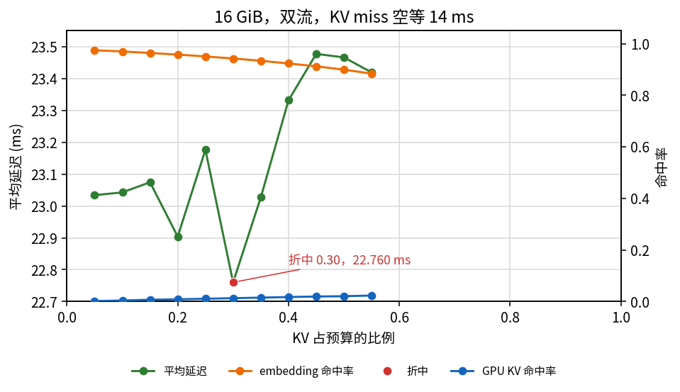

平均延迟在 22.760–23.478 ms。纵轴只画这一截。

0.30 的 22.760 ms 是最低。0.20 的 22.904 ms 也在同一凹底。过了 0.30 往上走，0.40 到 0.55 是 23.332、23.478、23.467、23.420 ms。红点折中标在 0.30。
