Total cache size: GPU 上的 KV cache 和 embedding cache 总量固定为 16 / 32 / 64 GiB。

Workload: 取 KuaiRand-27K 前半段，序列末尾 100 个 video 当作候选，再往前当作历史 his = 1k。因此 KV 全部命中时所需要的 cache size = 48.72 GiB，embedding 全部命中时所需要的 cache size = 3.08 GiB。
Model: `kuairand_1k_inference_ranking.gin`：N = 3，H = 4，d = 128，d_h = 512，s = 1024，t = 2048，c = 100。

Cache ratio: 0.05 - 0.95, 步长 = 0.05

# Overall

从实验结果来看，将结果分为下面三类。同流（his = 1k，预热和计时同一条）和双流（his = 4096，预热 seed=1 / 计时 seed=2）都按这三类分开看。

1. [KV 占主导](#sec-kv)：KV 的收益 > embedding 的收益，如 embedding table 位于 CPU。
  同流：embedding 一条请求全 miss 只有 0.033 ms，KV 一次命中省 0.052 ms。延迟随 KV 比例下降，最低在最右。
   [双流](#sec-kv-dual)：还是 CPU 参数表，仍是 KV 主导。GPU KV 命中只从 0.18% 到 4.1%，延迟几乎是平的，没有同流那种降到最右。
2. [embedding 占主导](#sec-emb)：embedding 的收益 > KV 的收益，如 embedding table 位于 Redis。
  同流：KV cache ratio 每增加 a，Redis 代价约 0.15a ms，KV 只省 0.052a ms。最低点在 embedding hit rate < 1 的临界点。
   [双流](#sec-emb-dual)：没有 embedding 全中的悬崖。最低在最左 / 左段，右边随 miss 上升。
3. [模拟实验](#sec-sim)：让 KV 的代价和 embedding 的代价沿 cache ratio 变化是同样量级。可以看到一个最低点。
   同流即使 his = 4k，embedding 也会先全中，miss 只占右边几格。双流上 KV miss 空等 14 ms、embedding 0.931 µs/id，能看见内部最低点，但这个点仍是 embedding miss 开始涨的格子（左边 embedding 刚盖不住 19.17 GiB）。

单条请求的全部命中 / 全部 miss。embedding 的 id 个数来自 1K 流量全部 8000 条请求：每条请求 unique video id 平均 1030。

|           | 全部命中                     | 全部 miss                                    |
| --------- | ------------------------ | ------------------------------------------ |
| KV        | GPU 7.88 µs；CPU 0.208 ms | 重算 0.515 ms                                |
| embedding | GPU 1.3 µs               | CPU 参数表 0.033 ms；Redis 一次 MGET **0.93 ms** |

双流换了 benchmark 流量：用户池全量合格用户，历史上限 4096，26000 条。预热 seed=1，计时 seed=2。池子 unique video 10,052,461 个，embedding 全中要 19.17 GiB，不再是同流的 3.08 GiB。KV 流大约 697 GiB。16 GiB 最左 embedding 只有 15.20 GiB，盖不住并集，从第一格就不是 embedding 全中。

这条流量上请求级 KV 全中 h 从 0.18% 到 4.1%，每条请求 embedding miss 个数 m 从大约 76 到 1500。一条请求因此多出来的时间（KV miss/hit + embedding miss，不含公共的候选计算）：

|         | f = 0.05 | f = 0.95 |
| ------- | -------- | -------- |
| CPU 参数表 | 0.52 ms  | 0.54 ms  |
| Redis   | 0.61 ms  | 1.83 ms  |

CPU 参数表几乎被 KV miss 钉死。Redis 右边已经是 embedding 主导。同一条双流把同流的 Phase1–4 再跑一遍（16 / 32 / 64，CPU 参数表、+32 GiB CPU KV、Redis）。14 ms 那档只用来把凹深拉到 0.03 ms/格，绝对延迟大约 23 ms，不再放大。

# 一、KV 占主导

## Phase1: KV miss uses recompute，embedding miss use CPU parameter table.

embedding 走 CPU 参数表。一次请求 KV 未命中是重算，命中是从 GPU 读：

$$
L_{\mathrm{miss}}-L_{\mathrm{hit}}=0.060-0.00788=0.052\ \mathrm{ms}
$$

一条请求 embedding 全部 miss 走 CPU 参数表 0.033 ms，全部命中 1.3 µs：

$$
L_{\mathrm{miss}}-L_{\mathrm{hit}}=0.033-0.0013=0.032\ \mathrm{ms}
$$

cache ratio 每变化一格 \Delta f，延迟变化是这个差乘上这一格命中（或 miss 个数）的变化。\Delta m 是一条请求 miss 的 id 个数：

$$
\begin{aligned}
\Delta L_{\mathrm{kv}}(f)&=0.052\ \mathrm{ms}\times\Delta h(f)\\
\Delta L_{\mathrm{emb}}(f)&=0.0325\ \mu\mathrm{s}\times\Delta m(f)
\end{aligned}
$$

KV miss 直接在 GPU 上重算。embedding miss 进 CPU 参数表。

每张图的左轴是平均延迟，右轴是命中率。蓝线是 GPU KV token 命中率。橙线是 embedding 命中率。

对于 KV 而言，未命中是重算，命中是从 GPU 读 KV。

### Total Cache size = 16 GiB

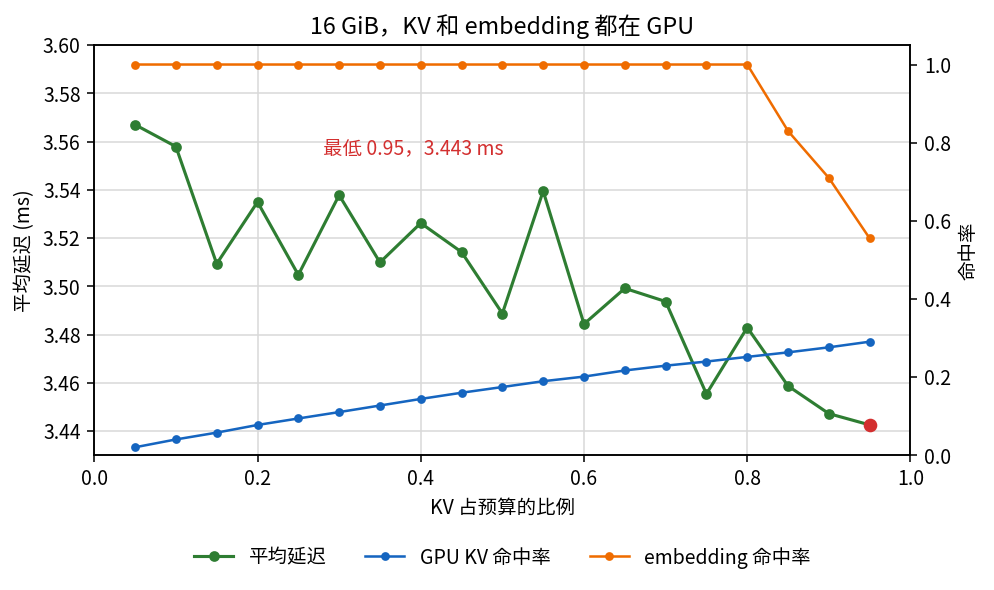

平均延迟随着 KV cache ratio 的增加而呈下降趋势。当 KV 比例 ≤ 0.80 时，embedding cache ≥ 16 × (1 − 0.80) = 3.20 GiB，embedding 命中率是 1。

因此，当 KV cache ratio < 0.80 时，embedding 的 hit rate = 1，latency 只和 KV 有关，随着 KV cache 增大，latency 逐渐减小。

当 KV cache ratio > 0.80 时，embedding hit rate < 1（KV cache ratio = 0.85、0.90、0.95 降到 0.830、0.710、0.555）。一条请求 embedding 全 miss 只有 0.033 ms，远小于 KV 命中省下的 0.052 ms。因此随着 KV cache ratio 增大，latency 降低。

### Total Cache size = 32 GiB

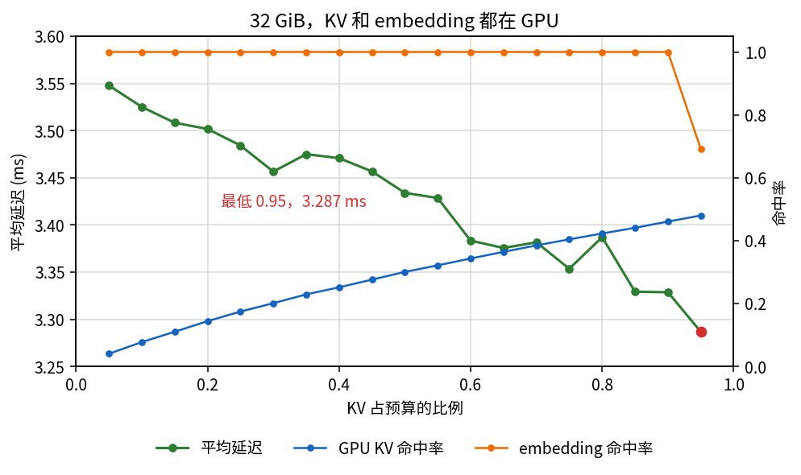

平均延迟随着 KV cache ratio 的增加而呈下降趋势。当 KV 比例 ≤ 0.90 时，embedding cache ≥ 32 × (1 − 0.90) = 3.20 GiB，embedding 命中率是 1。

因此，当 KV cache ratio < 0.90 时，embedding 的 hit rate = 1，latency 只和 KV 有关，随着 KV cache 增大，latency 逐渐减小。

当 KV cache ratio > 0.90 时，只有 0.95 这一格，embedding hit rate 降到 0.691。一条请求 embedding 全 miss 只有 0.033 ms，小于 KV 命中省下的 0.052 ms。

### Total Cache size = 64 GiB

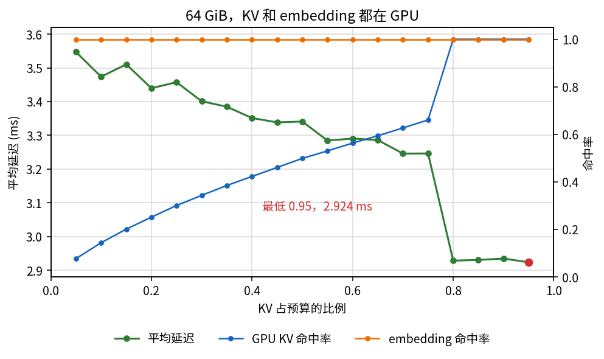

首先 KV cache ratio 从 0.05 - 0.95，embedding cache > 3.2GiB, embedding 是一定命中。当 KV cache ratio > 0.8 时，KV 开始全部命中。
因此，平均延迟随着 KV cache ratio 的增加而下降，KV 全中之后逐渐平缓。

# Phase2: KVCache and embedding cache in GPU，KV miss first CPU load and recompute，embedding miss use CPU parameter table.

GPU 上 KV 和 embedding 按比例划分。另外加一块固定的 32 GiB CPU KV cache (CPU hit rate： ～0.4)。KV 先查 GPU，没有再查这块 CPU cache，两边都没有才重算。embedding miss 进 CPU 参数表。KV 收益大于 embedding，延迟继续下降。

图的左轴仍是平均延迟，右轴是 GPU KV token 命中率和 embedding 命中率。

对于 KV 而言，三条路径是

$$
\begin{aligned}
L_{\mathrm{GPU}} &= 7.88\ \mu\mathrm{s} \\
L_{\mathrm{CPU}} &= 0.208\ \mathrm{ms} \\
L_{\mathrm{recompute}} &= 0.060\ \mathrm{ms}
\end{aligned}
$$

两两相减：

$$
\begin{aligned}
L_{\mathrm{CPU}}-L_{\mathrm{GPU}} &= 0.208-0.00788=0.200\ \mathrm{ms} \\
L_{\mathrm{recompute}}-L_{\mathrm{GPU}} &= 0.060-0.00788=0.052\ \mathrm{ms} \\
L_{\mathrm{recompute}}-L_{\mathrm{CPU}} &= 0.060-0.208=-0.148\ \mathrm{ms}
\end{aligned}
$$

第三行里 miss 是重算，hit 是 CPU 命中，所以 $L_{\mathrm{miss}}-L_{\mathrm{hit}}$ 是负的。CPU 命中最慢，GPU 命中最快，重算在中间。

对于 embedding 而言，一条请求全部 miss 走 CPU 参数表 0.033 ms，全部命中 1.3 µs。

$$
L_{\mathrm{miss}}-L_{\mathrm{hit}}=0.032\ \mathrm{ms}
$$

## Total Cache size = 16 GiB

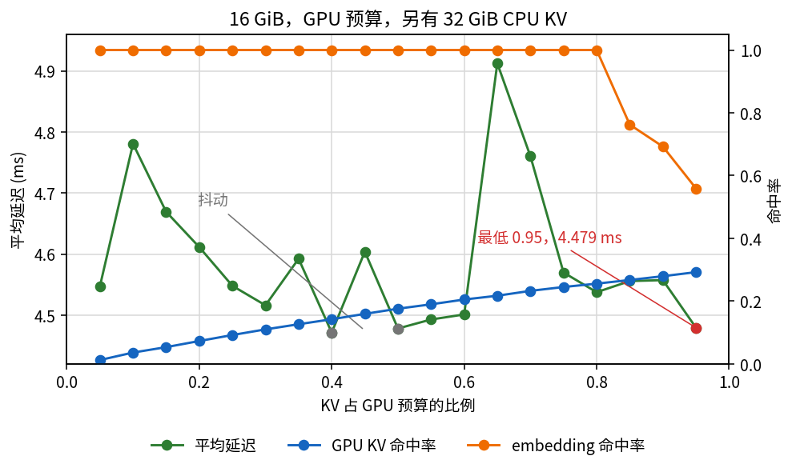

当 KV 比例 ≤ 0.80 时，embedding cache ≥ 16 × (1 − 0.80) = 3.20 GiB，命中率是 1。GPU KV 最大 12.80 GiB，小于 48.72 GiB，没有 KV 全部在 GPU 命中。
KV cache ratio = 0.05 时：GPU 命中 0.012，CPU 命中 0.430，重算 0.558。
KV cache ratio = 0.80：GPU 命中 0.256，CPU 命中 0.200，重算 0.544。

因此，随着 KV Cache ratio 的增加，GPU 命中率增加，GPU latency < CPU latency，因此平均延迟下降。

当 KV 比例 > 0.80 时，embedding hit rate 降到 0.559。随着 KV Cache ratio 的增加，GPU 命中率增加，embedding hit rate 下降，但是 KV cache 收益 > embedding 收益，所以 latency 同样下降。0.40 的 4.471 ms 和 0.50 的 4.478 ms 是抖动。最低在 0.95，4.479 ms。

## Total Cache size = 32 GiB

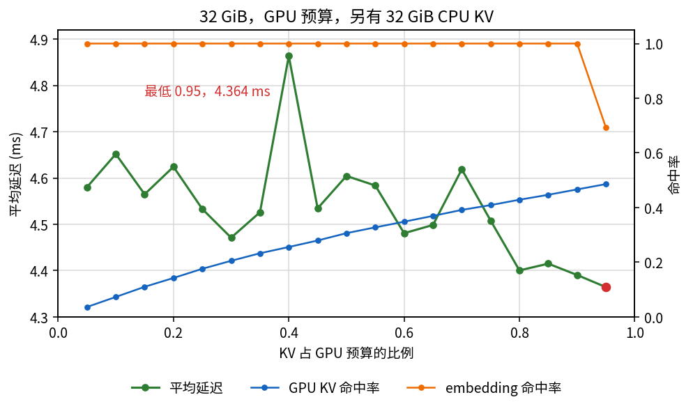

当 KV 比例 ≤ 0.90 时，embedding cache ≥ 32 × (1 − 0.90) = 3.20 GiB，命中率是 1。GPU KV 最大 28.80 GiB，小于 48.72 GiB，没有 KV 全部在 GPU 命中。
KV cache ratio = 0.05 时：GPU 命中 0.036，CPU 命中 0.415，重算 0.549。
KV cache ratio = 0.90：GPU 命中 0.466，CPU 命中 0.027，重算 0.507。

因此，随着 KV Cache ratio 的增加，GPU 命中率增加，GPU latency < CPU latency，因此平均延迟下降。

当 KV 比例 > 0.90 时，只有 0.95 这一格，embedding hit rate 降到 0.692。随着 KV Cache ratio 的增加，GPU 命中率增加，embedding hit rate 下降，但是 KV cache 收益 > embedding 收益，所以 latency 同样下降。

## Total Cache size = 64 GiB

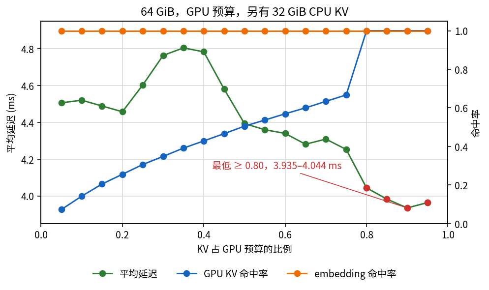

当 KV 比例 ≤ 0.95 时，embedding cache ≥ 64 × (1 − 0.95) = 3.20 GiB，命中率是 1。KV 全部在 GPU 命中从比例 0.80 开始，GPU KV = 51.20 GiB，大于 48.72 GiB。
KV cache ratio = 0.05 时：GPU 命中 0.073，CPU 命中 0.378，重算 0.549。
KV cache ratio = 0.80：GPU 命中 1，CPU 命中 0，重算 0。

因此，随着 KV Cache ratio 的增加，GPU 命中率增加，GPU latency < CPU latency，因此平均延迟下降。比例 ≥ 0.80 的 0.80、0.85、0.90、0.95 都是最低这一档，延迟在 3.935–4.044 ms。KV 已经全部在 GPU 命中，embedding hit rate 仍是 1。

## 双流：KV miss uses recompute，embedding miss use CPU parameter table.

同一条双流，工作集见 Overall。GPU 上 KV 和 embedding 按比例划分。KV miss 在 GPU 上重算。embedding miss 进 CPU 参数表，没有额外等待。

一条请求 embedding 全 miss 仍是 0.033 ms，KV 未命中重算 0.515 ms，还是 KV 主导。但 GPU KV 命中只从 0.18% 涨到 4.1%（16 GiB）/ 7.3% / 13.3%，每格 \Delta h \approx 0.002，KV 只省大约 0.001 ms。embedding 命中往下掉时 \Delta m 最大大约 391，CPU 参数表大约 0.012 ms。两边都被大约 0.04 ms 的抖动盖住，所以图是平的，不是同流那种降到最右。

$$
\begin{aligned}
\Delta L_{\mathrm{kv}}(f)&=0.515\,\Delta h(f)\ \mathrm{ms}\\
\Delta L_{\mathrm{emb}}(f)&=0.031\ \mu\mathrm{s}\times\Delta m(f)
\end{aligned}
$$

图的左轴是平均延迟，右轴是命中率。蓝线是 GPU KV token 命中率。橙线是 embedding 命中率。不标折中。

### Total Cache size = 16 GiB

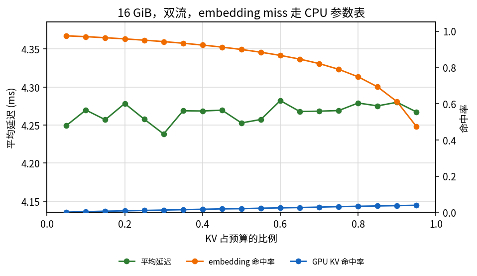

平均延迟在 4.238–4.282 ms，跨度 0.044 ms。embedding 命中从约 0.97 降到 0.47，延迟不跟着掉。0.30 的 4.238 ms 是数值最低，看成毛刺，不标折中。

### Total Cache size = 32 GiB

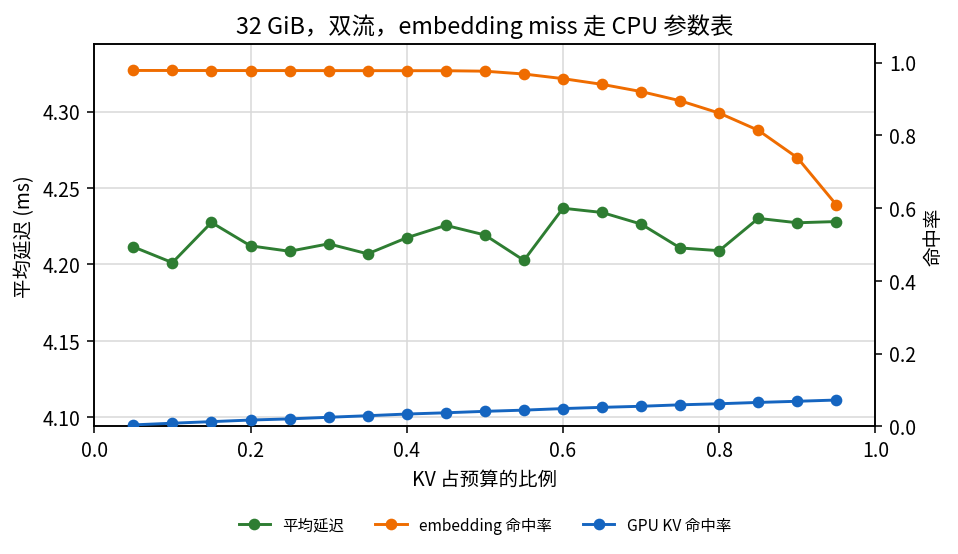

平均延迟在 4.201–4.237 ms，跨度 0.036 ms，和 16 GiB 一样几乎是平的。KV token 命中从 0.41% 升到 7.3%。embedding 命中率左边约 0.979，0.50 起往下掉，0.95 到 0.609，延迟几乎不跟着掉。数值最低在 0.10，不标折中。

### Total Cache size = 64 GiB

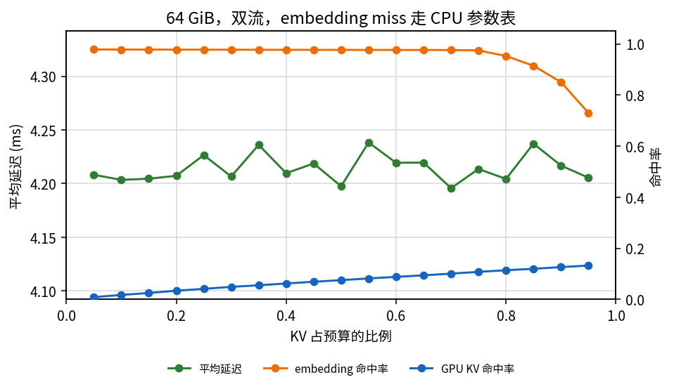

平均延迟在 4.196–4.238 ms，跨度 0.042 ms，同样几乎是平的。KV token 命中从 0.88% 升到 13.3%。embedding 命中率到 0.70 还约 0.976，0.95 到 0.730，延迟同样几乎不跟着掉。数值最低在 0.70，不标折中。

## 双流：GPU 预算加 32 GiB CPU KV，embedding miss 走 CPU 参数表.

同一条双流。GPU 上 KV 和 embedding 按比例划分，另外加一块固定的 32 GiB CPU KV。CPU KV token 命中锁在 6.82%（32 / 697 的 Zipf 头）。embedding 仍走 CPU 参数表，还是 KV 主导这一类。绝对延迟比不加 CPU KV 大约高 1.3 ms。不标折中。

### Total Cache size = 16 GiB

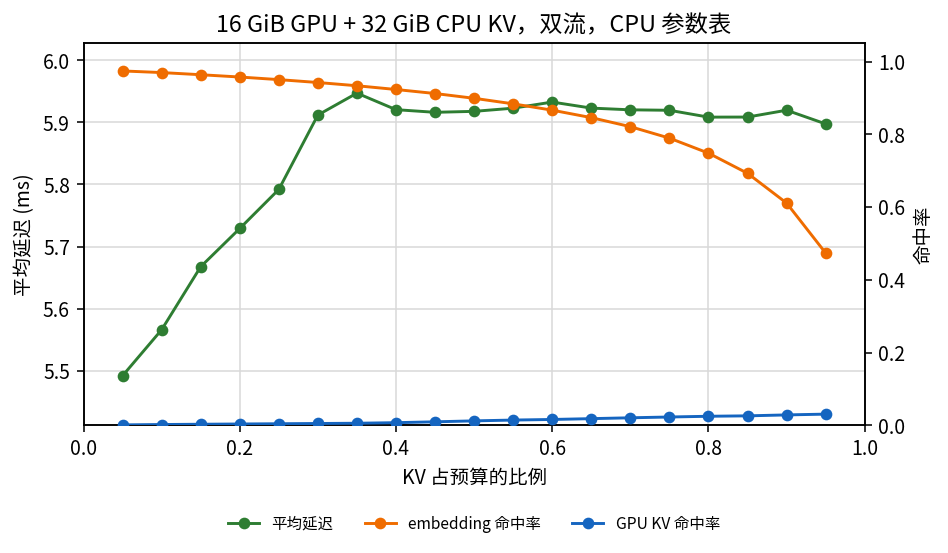

平均延迟从 0.05 的 5.492 ms 升到 0.35 的 5.947 ms，之后走平在 5.90–5.93 ms。0.35 之后 embedding 命中继续往下掉，延迟不再跟。CPU KV token 命中一直是 6.82%，GPU KV 从 0.14% 升到 3.1%。最低在最左 0.05，不标折中。

### Total Cache size = 32 GiB

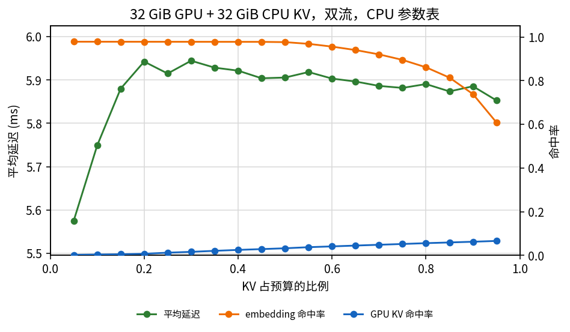

平均延迟从 0.05 的 5.575 ms 升到 0.30 的 5.945 ms，之后缓缓降到 0.95 的 5.853 ms，仍高于最左。CPU KV 命中仍是 6.82%，GPU KV 从 0.24% 升到 6.6%。最低在最左 0.05，不标折中。

### Total Cache size = 64 GiB

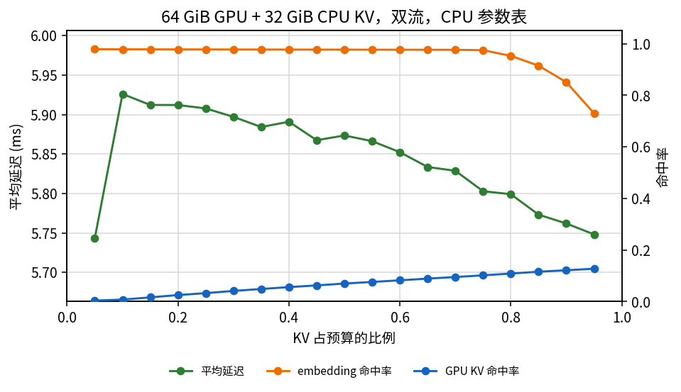

平均延迟从 0.05 的 5.743 ms 升到 0.10 的 5.926 ms，之后随 GPU KV 降到 0.95 的 5.748 ms，几乎回到最左。embedding 命中到 0.70 还约 0.976，右边掉下去时延迟仍在降。CPU KV 命中仍是 6.82%，GPU KV 从 0.38% 升到 12.7%。最低在最左 0.05，不标折中。

# 二、embedding 占主导

embedding 走 Redis 时，一条请求全部 miss 是一次 MGET **0.93 ms**，全部命中不必打 Redis，取数是 0。有 m 个 miss 时是 30 µs + 0.87 µs × m。

## Phase3: KV miss uses recompute，embedding miss use Redis.

KV miss 直接在 GPU 上重算。embedding miss 进本机 Redis。

每张图的左轴是平均延迟，右轴是命中率。绿线是粗扫实测，浅绿三角是细扫实测，灰虚线是理论延迟。蓝线是 GPU KV token 命中率。橙线是 embedding 命中率。红点是 trade off，标在 embedding 还能全中的最后一格。

对于 KV 而言，未命中是重算，命中是从 GPU 读 KV。

$$
L_{\mathrm{miss}}-L_{\mathrm{hit}}=0.060-0.00788=0.052\ \mathrm{ms}
$$

对于 embedding 而言，一条请求全部 miss 走 Redis 0.93 ms，全部命中 0。

$$
L_{\mathrm{miss}}-L_{\mathrm{hit}}=0.93\ \mathrm{ms}
$$

0.93 ms 大约是 KV 差 0.052 ms 的 18 倍。cache ratio 每动一格要比的是：

$$
\begin{aligned}
\Delta L_{\mathrm{kv}}(f)&=0.052\ \mathrm{ms}\times\Delta h(f)\\
\Delta L_{\mathrm{emb}}(f)&=0.030\ \mathrm{ms}+0.87\ \mu\mathrm{s}\times\Delta m(f)
\end{aligned}
$$

\Delta m 是每条请求 miss 的 video id 个数，embedding hit rate < 1 后大约 90–350。16 GiB 从 0.80 到 0.85，\Delta h \approx 0.011，KV 只省 0.0006 ms；\Delta m = 136，Redis 大约 0.15 ms。所以 embedding 主导时，折中在 embedding hit rate < 1 的临界点。

### Total Cache size = 16 GiB

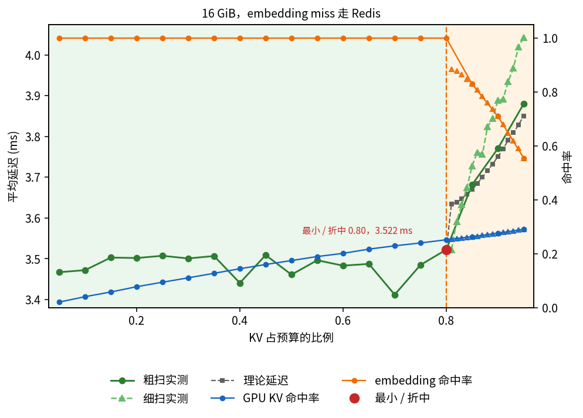

当 KV 比例 ≤ 0.80 时，embedding cache ≥ 16 × (1 − 0.80) = 3.20 GiB，命中率是 1，miss 个数是 0。0.05 到 0.80 平均延迟 3.412–3.522 ms，是波动。

embedding hit rate < 1 的临界点在 0.80。之后命中率和每条请求 miss 的 video id 个数：

- 0.80：命中率 1，miss 0
- 0.81 ：命中率 0.884，miss 约 94
- 0.85：命中率 0.830，miss 约 136
- 0.90：命中率 0.710，miss 约 229
- 0.95：命中率 0.555，miss 约 345

miss 个数大约 90–350。粗扫从 0.80 的 3.522 ms 升到 0.85、0.90、0.95 的 3.682、3.771、3.880 ms，升高 0.160、0.249、0.358 ms。理论取数 0.15、0.23、0.33 ms，和粗扫同一档。细扫在另一台 6k 机器上，绝对延迟从 0.81 的 3.969 ms 升到 0.95 的 4.489 ms，叠在同一张图上，格子更密，latency 仍呈现上升的趋势。

### Total Cache size = 32 GiB

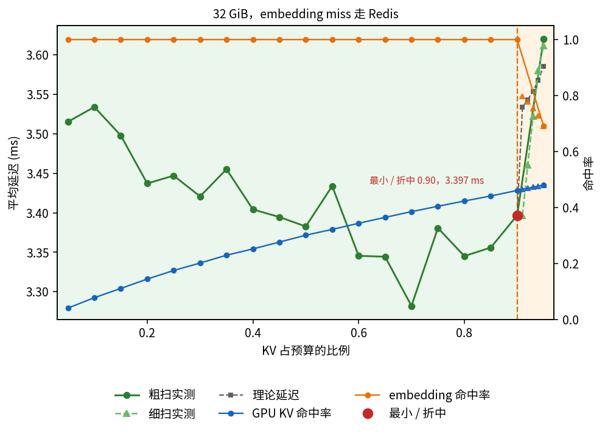

当 KV 比例 ≤ 0.90 时，embedding cache ≥ 32 × (1 − 0.90) = 3.20 GiB，命中率是 1，miss 个数是 0。这一段是波动，不标最低点。

embedding hit rate < 1 的临界点在 0.90。之后：

- 0.90：命中率 1，miss 0
- 0.91 ：命中率 0.797，miss 约 123
- 0.95：命中率 0.691，miss 约 184

miss 个数大约 120–180。粗扫从 0.90 的 3.397 ms 升到 0.95 的 3.620 ms，升高 0.223 ms，理论取数 0.19 ms。细扫在另一台机器上，绝对延迟从 0.91 的 3.901 ms 升到 0.95 的 4.116 ms，呈上升趋势。

### Total Cache size = 64 GiB

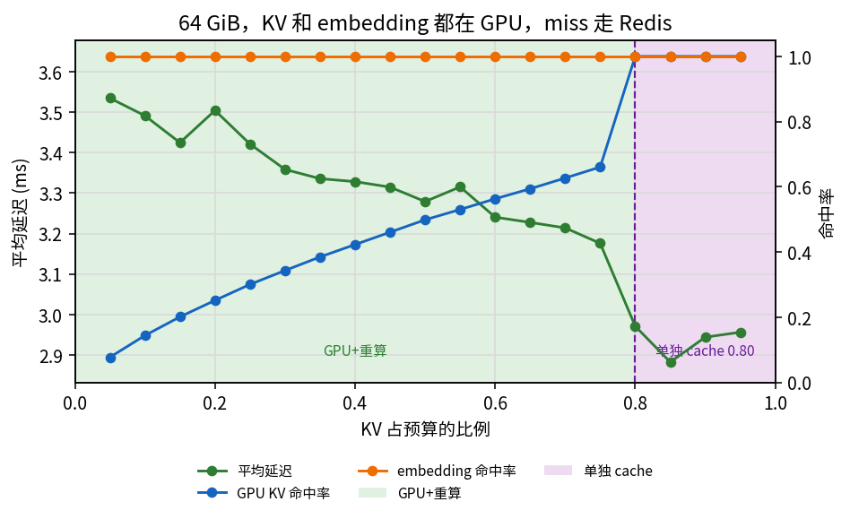

KV 比例从 0.05 到 0.95，embedding cache ≥ 3.20 GiB，命中率是 1，请求没有进 Redis，没有embedding hit rate < 1 的点。0.80 之前是 GPU+重算。KV 全部命中从比例 0.80 开始，GPU KV = 51.20 GiB，大于 48.72 GiB，这一段是单独 cache。

因此，平均延迟随着 KV cache ratio 的增加而下降，KV 全中之后走平。0.80、0.85、0.90、0.95 的延迟是 2.971、2.883、2.944、2.956 ms，差 0.06–0.09 ms。

## Phase4: 1K，KV 加 32 GiB CPU cache，embedding miss 走 Redis.

embedding miss 进本机 Redis。

图的左轴是平均延迟，右轴是 GPU KV token 命中率和 embedding 命中率。

对于 KV 而言，三条路径是

$$
\begin{aligned}
L_{\mathrm{GPU}} &= 7.88\ \mu\mathrm{s} \\
L_{\mathrm{CPU}} &= 0.208\ \mathrm{ms} \\
L_{\mathrm{recompute}} &= 0.060\ \mathrm{ms}
\end{aligned}
$$

$$
\begin{aligned}
L_{\mathrm{CPU}}-L_{\mathrm{GPU}} &= 0.200\ \mathrm{ms} \\
L_{\mathrm{recompute}}-L_{\mathrm{GPU}} &= 0.052\ \mathrm{ms} \\
L_{\mathrm{recompute}}-L_{\mathrm{CPU}} &= -0.148\ \mathrm{ms}
\end{aligned}
$$

对于 embedding 而言，一条请求全部命中取数是 0，全部 miss 是一次 MGET 0.93 ms。有 m 个 miss 时是 30 µs + 0.87 µs × m。

## Total Cache size = 16 GiB

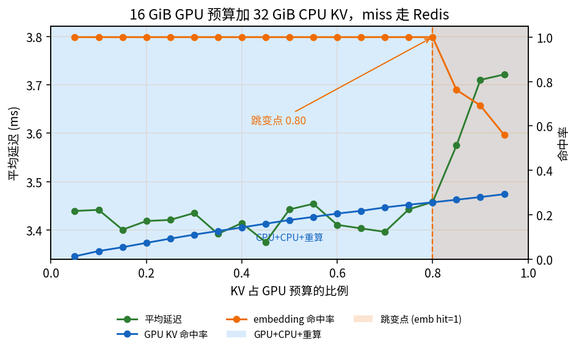

当 KV 比例 ≤ 0.80 时，embedding cache ≥ 16 × (1 − 0.80) = 3.20 GiB，命中率是 1，embedding miss 时间是 0。GPU KV 最大 12.80 GiB，小于 48.72 GiB，没有 KV 全部在 GPU 命中。
KV cache ratio = 0.05 时：GPU 命中 0.012，CPU 命中 0.430，重算 0.558。
KV cache ratio = 0.80：GPU 命中 0.256，CPU 命中 0.201，重算 0.544。
这一段平均延迟 3.375–3.458 ms，是波动。

embedding hit rate < 1 的临界点在 0.80，这是 embedding 命中率最后一次等于 1 的格子。之后 0.85、0.90、0.95 降到 0.762、0.692、0.559。每条请求的 miss 是 137、177、254 次，取数时间是 0.134、0.171、0.244 ms。平均延迟从 0.80 的 3.458 ms 升到 0.95 的 3.721 ms，升高 0.263 ms。

### Total Cache size = 32 GiB

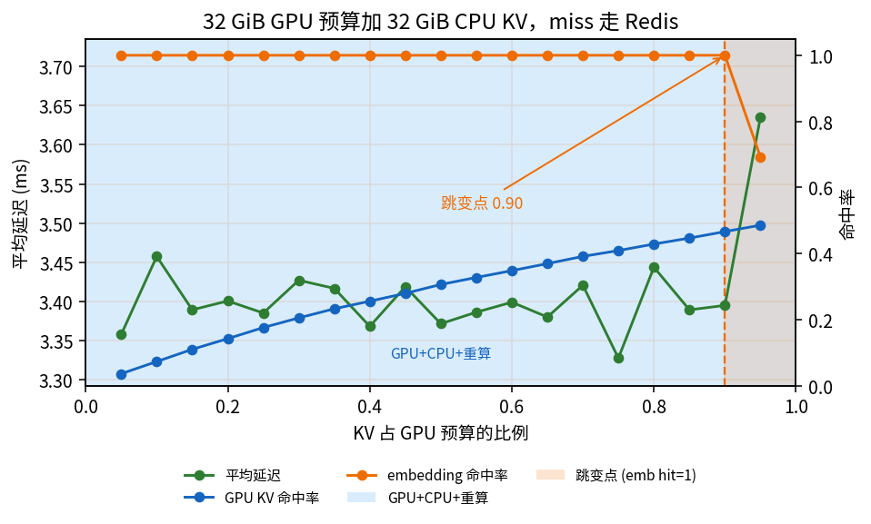

当 KV 比例 ≤ 0.90 时，embedding cache ≥ 32 × (1 − 0.90) = 3.20 GiB，命中率是 1，embedding miss 时间是 0。GPU KV 最大 28.80 GiB，小于 48.72 GiB，没有 KV 全部在 GPU 命中。
KV cache ratio = 0.05 时：GPU 命中 0.036，CPU 命中 0.415，重算 0.549。
KV cache ratio = 0.90：GPU 命中 0.466，CPU 命中 0.027，重算 0.507。
这一段是波动，不标最低点。

embedding hit rate < 1 的临界点在 0.90，这是 embedding 命中率最后一次等于 1 的格子。之后只有 0.95，命中率 0.692。每条请求 177 次 miss，取数时间 0.171 ms。平均延迟从 0.90 的 3.395 ms 升到 3.635 ms，升高 0.240 ms。

### Total Cache size = 64 GiB

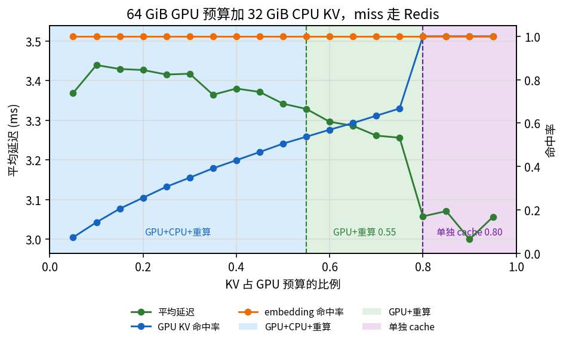

KV 比例从 0.05 到 0.95，embedding cache ≥ 3.20 GiB，命中率是 1，embedding miss 时间是 0，没有embedding hit rate < 1 的点。0.55 之前是 GPU+CPU+重算，0.55 到 0.80 是 GPU+重算（CPU 独占命中已经是 0）。KV 全部在 GPU 命中从比例 0.80 开始，GPU KV = 51.20 GiB，大于 48.72 GiB，这一段是单独 cache。
KV cache ratio = 0.05 时：GPU 命中 0.073，CPU 命中 0.378，重算 0.549。
KV cache ratio = 0.80：GPU 命中 1，CPU 命中 0，重算 0。

因此，随着 KV cache ratio 的增加，GPU 命中从 CPU 命中里换出来，平均延迟下降。KV 全中之后走平。0.80、0.85、0.90、0.95 是 3.058、3.071、3.000、3.056 ms。

## Phase3-H4K: his = 4096，KV miss uses recompute，embedding miss use Redis.

GPU 上 KV 和 embedding 按比例划分，没有额外的 CPU KV。同一份 KuaiRand-27K 前半段，历史上限 4096。KV 工作集是 146.44 GiB，embedding 全部命中要 6.75 GiB。KV miss 在 GPU 上重算。embedding miss 进本机 Redis。

一条请求全部命中取数是 0。有 m 个 miss 时是 30 µs + 0.87 µs × m。

### Total Cache size = 16 GiB

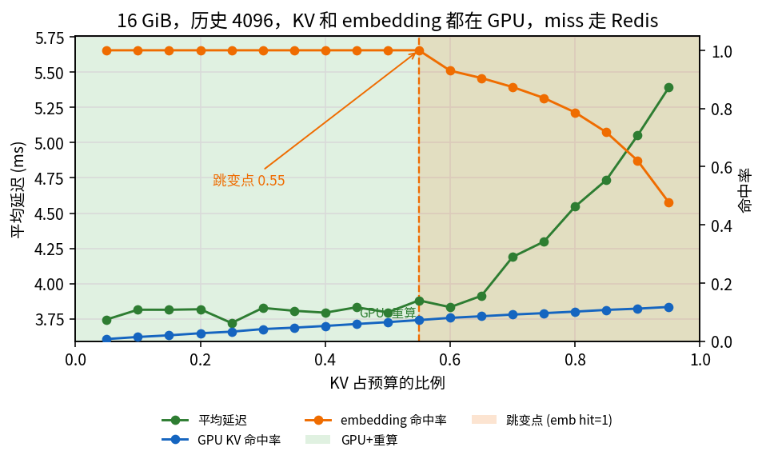

当 KV 比例 ≤ 0.55 时，embedding cache ≥ 16 × (1 − 0.55) = 7.20 GiB，命中率是 1。0.05 到 0.55 的 miss 时间都是 0。GPU KV 最大 15.20 GiB，小于 146.44 GiB，请求命中从 0.008 升到 0.074。平均延迟 3.720–3.881 ms，是波动。

embedding hit rate < 1 的临界点在 0.55，这是 embedding 命中率最后一次等于 1 的格子。之后 0.60 到 0.95 降到 0.930、0.905、0.874、0.836、0.787、0.718、0.621、0.477。每条请求的 miss 是 191、258、340、439、569、746、999、1369 次，取数时间是 0.177、0.238、0.312、0.401、0.516、0.673、0.895、1.219 ms。0.60 的平均延迟 3.833 ms 仍在全中段的抖动里；从 0.70 的 4.189 ms 升到 0.95 的 5.391 ms。0.95 的 GPU KV token 命中是 0.118。

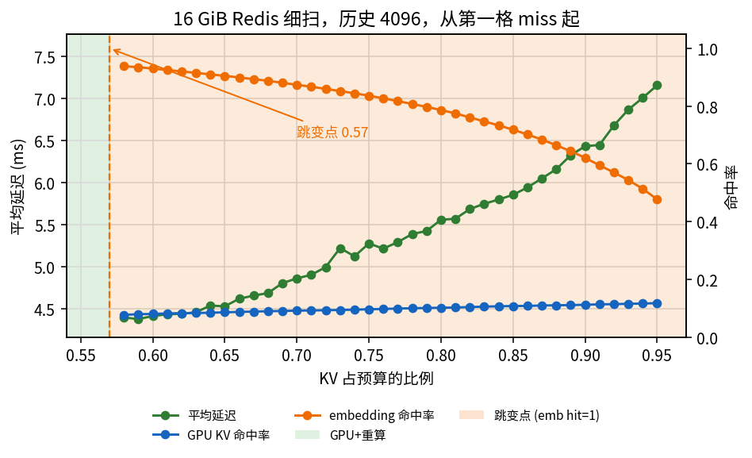

### Total Cache size = 32 GiB

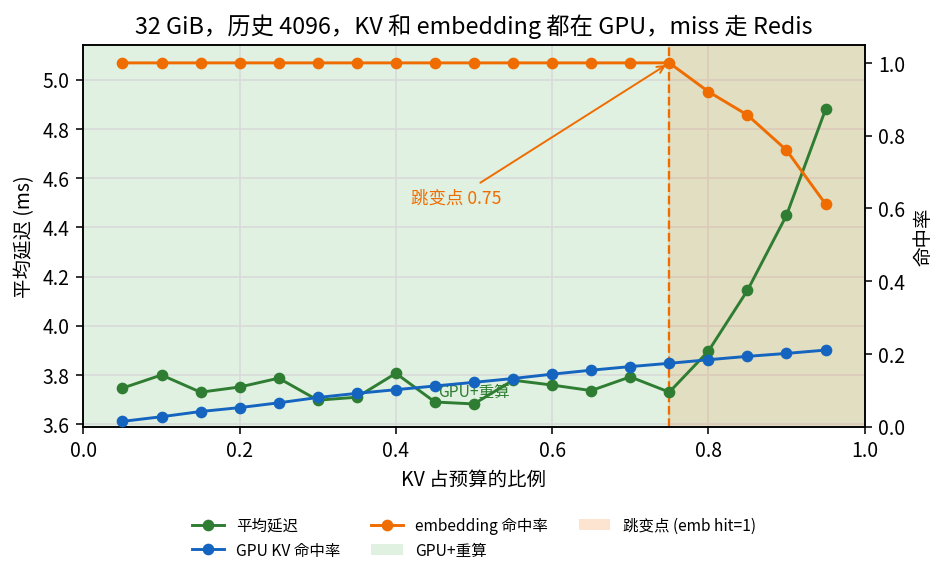

当 KV 比例 ≤ 0.75 时，embedding cache ≥ 32 × (1 − 0.75) = 8.00 GiB，命中率是 1。embedding hit rate < 1 时，latency 开始上升。

### Total Cache size = 64 GiB

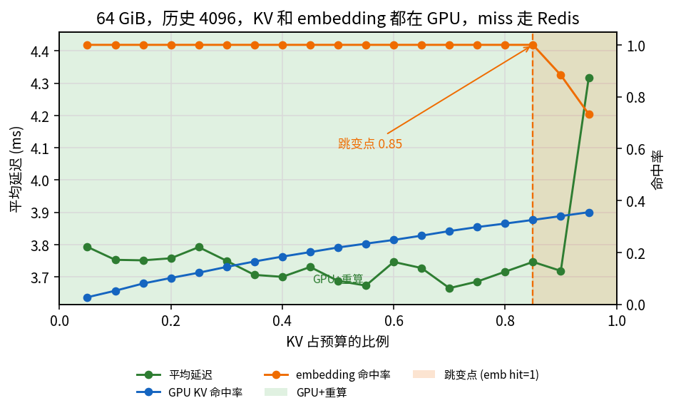

当 KV 比例 ≤ 0.85 时，embedding cache ≥ 64 × (1 − 0.85) = 9.60 GiB，命中率是 1。0.05 到 0.85 的 miss 时间都是 0。GPU KV 最大 54.40 GiB，小于 146.44 GiB，没有 KV 全部命中。

## 双流：KV miss uses recompute，embedding miss use Redis.

同一条双流。GPU 上 KV 和 embedding 按比例划分。KV miss 在 GPU 上重算。embedding miss 进本机 Redis，一次请求是一次 MGET：30 µs + 0.87 µs × m。16 GiB 最左 embedding 只有 15.20 GiB，盖不住 19.17 GiB 的并集，没有 embedding 全中的悬崖。

每格 \Delta h \approx 0.002，KV 只省大约 0.001 ms。m 从大约 76 涨到 1506，Redis 额外时间从 0.61 ms 升到 1.83 ms。右边是 embedding 主导，最低在最左 / 左段，没有内部凹点。

$$
L(f)=0.515\,(1-h(f))\ \mathrm{ms}+0.030\ \mathrm{ms}+0.87\ \mu\mathrm{s}\times m(f)
$$

$$
\begin{aligned}
\Delta L_{\mathrm{kv}}(f)&=0.515\,\Delta h(f)\ \mathrm{ms}\\
\Delta L_{\mathrm{emb}}(f)&=0.87\ \mu\mathrm{s}\times\Delta m(f)
\end{aligned}
$$

### Total Cache size = 16 GiB

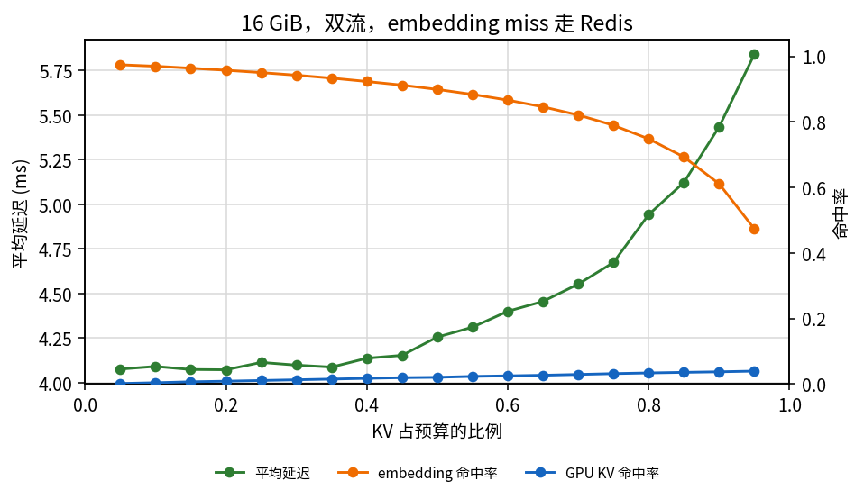

平均延迟在 4.073–5.840 ms。

0.05 到 0.35 是 4.076、4.091、4.074、4.073、4.114、4.099、4.088 ms，是波动。数值最低在 0.20 的 4.073 ms，只比最左低 0.004 ms，看成毛刺，不标折中。0.40 之后随 miss 个数上去：0.50 的 4.256 ms，0.80 的 4.942 ms，0.95 的 5.840 ms。跨度 1.768 ms。embedding 命中从 0.974 降到 0.474，KV token 命中从 0.17% 升到 4.0%。

### Total Cache size = 32 GiB

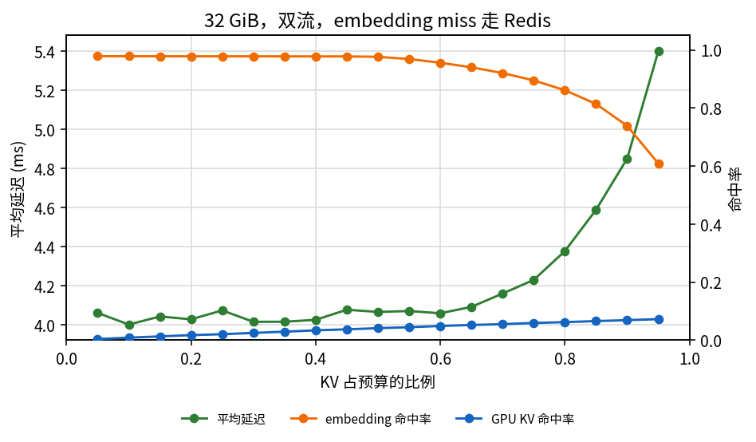

平均延迟在 4.002–5.401 ms。

0.40 及以前 embedding 预算 ≥ 19.20 GiB，盖得住 19.17 GiB 的并集；0.45 起小于并集。预热和计时不是同一条流，左边仍然不是 embedding 全中，但 miss 更少。0.05 到 0.65 是 4.002–4.092 ms，是波动。数值最低在 0.10 的 4.002 ms，不标折中。0.70 之后随 miss 上去：0.80 的 4.378 ms，0.90 的 4.851 ms，0.95 的 5.401 ms。跨度 1.399 ms，比 16 GiB 的 1.768 ms 短，抬头也更晚。KV token 命中从 0.41% 升到 7.3%。

### Total Cache size = 64 GiB

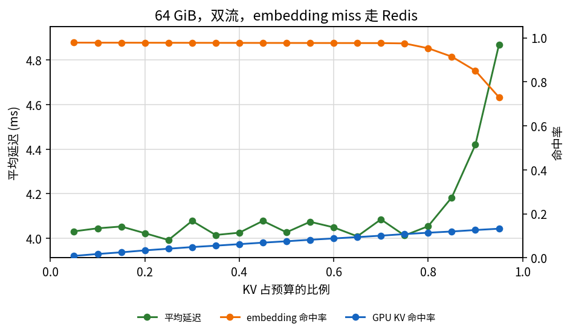

平均延迟在 3.993–4.869 ms。

0.70 及以前 embedding 预算 ≥ 19.20 GiB，盖得住并集；0.75 起小于并集。0.05 到 0.80 是 3.993–4.085 ms，是波动。数值最低在 0.25 的 3.993 ms，比最左低 0.039 ms，不标折中。0.85 之后随 miss 上去：0.90 的 4.420 ms，0.95 的 4.869 ms。跨度 0.877 ms，比 32 GiB 更短、抬头更晚。KV token 命中从 0.88% 升到 13.3%。没有凹点。

## 双流：GPU 预算加 32 GiB CPU KV，embedding miss 走 Redis.

同一条双流。GPU 上 KV 和 embedding 按比例划分，另外加一块固定的 32 GiB CPU KV。KV 先查 GPU，没有再查这块 CPU cache。embedding miss 进本机 Redis。没有 embedding 全中的悬崖。CPU KV token 命中锁在 6.82%。最低在最左，右边随 Redis miss 上升。

### Total Cache size = 16 GiB

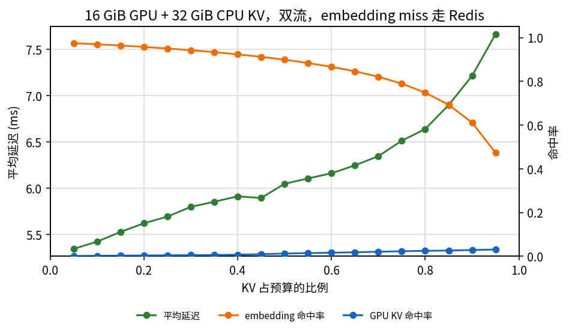

平均延迟在 5.345–7.662 ms。

最低在最左 0.05 的 5.345 ms，之后一路升到 0.95 的 7.662 ms。跨度 2.318 ms，比不加 CPU KV 的 Redis 16 GiB（1.768 ms）更长，左边也比那档高大约 1.27 ms。没有凹点，不标折中。CPU KV 命中一直是 6.82%，GPU KV 从 0.14% 升到 3.1%。

### Total Cache size = 32 GiB

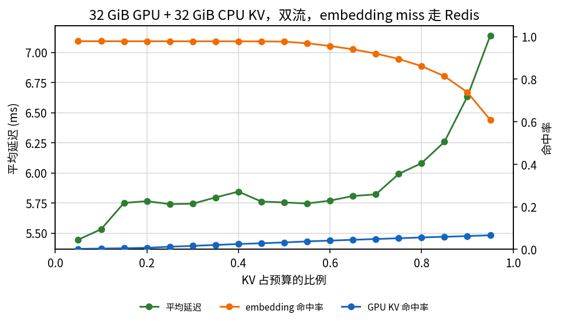

平均延迟在 5.445–7.139 ms。

最低在最左 0.05 的 5.445 ms。0.05 到 0.70 是 5.445–5.844 ms，是波动；0.15 的 5.750 ms 是这段里的局部高点，不是谷。0.75 之后随 miss 上去：0.85 的 6.258 ms，0.95 的 7.139 ms。跨度 1.694 ms，比 16 GiB 短、抬头更晚。没有凹点，不标折中。CPU KV 命中仍是 6.82%，GPU KV 从 0.24% 升到 6.6%。

### Total Cache size = 64 GiB

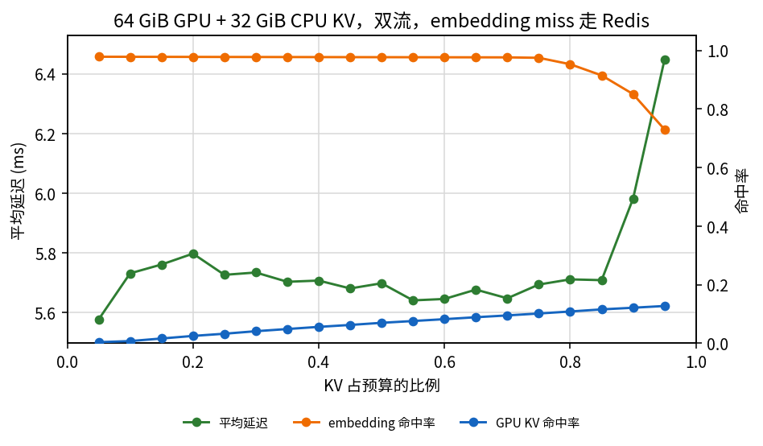

平均延迟在 5.576–6.448 ms。

最低在最左 0.05 的 5.576 ms。0.05 到 0.85 是 5.576–5.797 ms，是波动。0.90、0.95 随 miss 升到 5.981、6.448 ms。跨度 0.872 ms，比 32 GiB 更短、抬头更晚。没有凹点，不标折中。CPU KV 命中仍是 6.82%，GPU KV 从 0.38% 升到 12.7%。

# 三、模拟实验：两边权衡

双流设定见 Overall。第一节 CPU 参数表、第二节 Redis 在双流上仍然一边倒：CPU 参数表几乎是平的，Redis 最低在左、右边拉起来。这一节把 KV miss 空等放大到 14 ms，左边 m 还没涨的时候延迟能随 KV 往下走，m 一开始涨就抬起来。最低点仍是 embedding miss 开始涨的格子。

## Phase7-wait: KV miss 空等 14 ms，embedding miss 0.931 µs/id.

同一条双流。KV 工作集大约 697 GiB，命中几乎不涨。16 / 32 / 64 GiB 上 GPU KV 命中全程只增加 0.038 / 0.068 / 0.124。不空等、按重算 0.515 ms 算，KV 全程只省 0.019 / 0.035 / 0.064 ms，CPU 参数表 embedding 全程只有 0.044 / 0.032 / 0.020 ms，都被抖动盖住。

这一节给 KV miss 空等 14 ms、embedding miss 空等 0.931 µs/id：

$$
L(f)=14.515\,(1-h(f))\ \mathrm{ms}+0.931\ \mu\mathrm{s}\times m(f)
$$

$$
\begin{aligned}
\Delta L_{\mathrm{kv}}(f)&=14.515\,\Delta h(f)\ \mathrm{ms}\\
\Delta L_{\mathrm{emb}}(f)&=0.931\ \mu\mathrm{s}\times\Delta m(f)
\end{aligned}
$$

| | KV 全程 | embedding 全程 | KV 每格（m 未涨） | embedding 每格（m 开始涨之后） |
|---|---|---|---|---|
| 16 GiB | 0.55 ms | 1.33 ms | ~0.03 ms | 第一格就在涨，0.01 → 0.36 ms |
| 32 GiB | 0.99 ms | 0.95 ms | ~0.055 ms | 0.50 起涨，0 → 0.33 ms |
| 64 GiB | 1.80 ms | 0.59 ms | ~0.10 ms | 0.75 起涨，0 → 0.29 ms |

32 / 64 左边 embedding 预算还盖得住 19.17 GiB 并集时，m 停在大约 64（计时里预热没见过的 id），\(\Delta L_{\mathrm{emb}}=0\)，只随 KV 降。预算一小于 19.17 GiB，m 离开这条地板，embedding 每格很快超过 KV。所以最低点就是这条临界，和同流 Redis「embedding hit rate < 1」是同一类点，不是两条斜率全程对打。16 GiB 最左 embedding 只有 15.20 GiB，m 从第一格就在涨，没有这段地板，图也更抖。

图的左轴是平均延迟，右轴是命中率。蓝线是 GPU KV token 命中率。橙线是 embedding 命中率。红点标在 GPU 最低。

### Total Cache size = 16 GiB

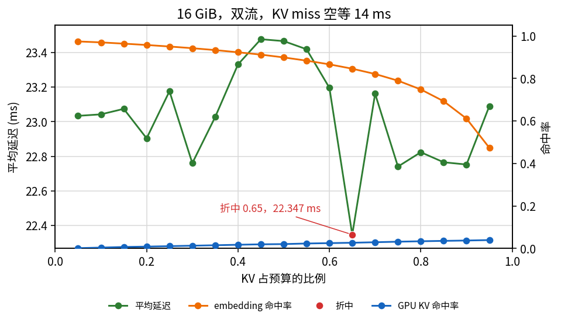

平均延迟在 22.347–23.478 ms。

0.65 的 22.347 ms 是最低。0.30 的 22.760 ms 是左边凹底。过了 0.30 抬到 0.45 的 23.478 ms（全程最高），再掉到 0.65。右边 0.75–0.90 是 22.740、22.823、22.765、22.752 ms，仍高于 0.65；0.95 回到 23.091 ms。红点折中标在 0.65。

### Total Cache size = 32 GiB

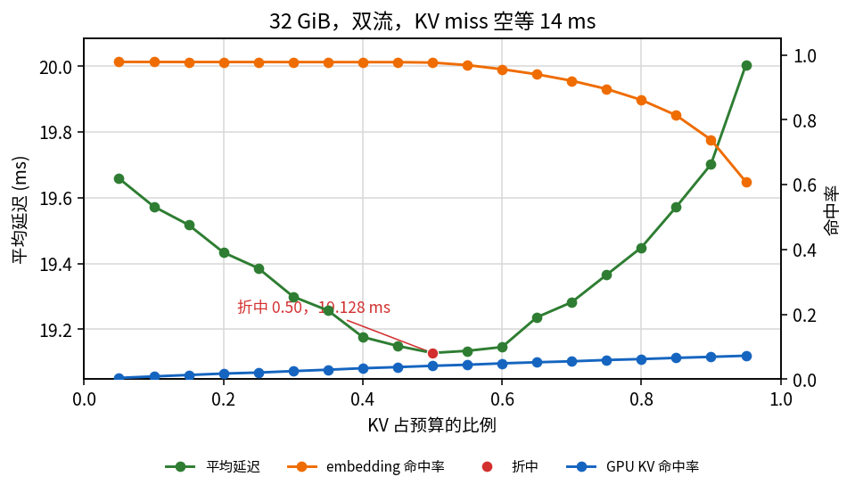

平均延迟在 19.128–20.004 ms。

0.40 及以前 embedding ≥ 19.20 GiB，m 停在 63.5，每格 KV 省大约 0.055 ms，embedding 是 0，延迟只往下走。0.45 起小于 19.17 GiB；0.50 的 m = 67.0，开始离开地板。GPU 最低在 **0.50 的 19.128 ms**，0.55、0.60 是 19.135、19.146 ms。之后 embedding 每格 0.02 → 0.33 ms，超过 KV，升到 0.95 的 20.004 ms。红点标在 0.50。KV token 命中从 0.41% 升到 7.3%。

### Total Cache size = 64 GiB

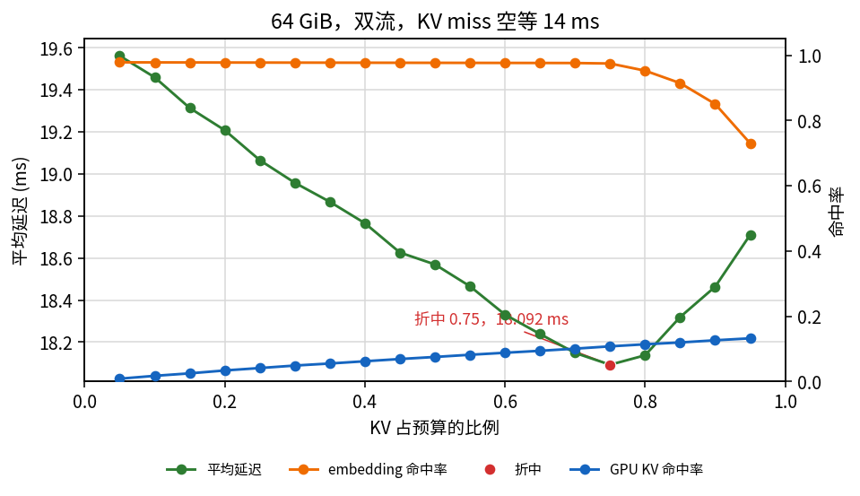

平均延迟在 18.092–19.562 ms。

0.70 及以前 embedding ≥ 19.20 GiB，m 停在 63.5，每格 KV 省大约 0.10 ms，延迟从 0.05 的 19.562 ms 一路降到 0.70 的 18.149 ms。0.75 起 embedding = 16.00 GiB，m = 67.0。GPU 最低在 **0.75 的 18.092 ms**，之后 embedding 每格 0.05 → 0.29 ms，升到 0.95 的 18.711 ms，仍低于最左。红点标在 0.75。KV token 命中从 0.88% 升到 13.3%。