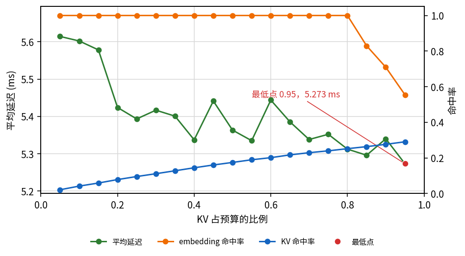
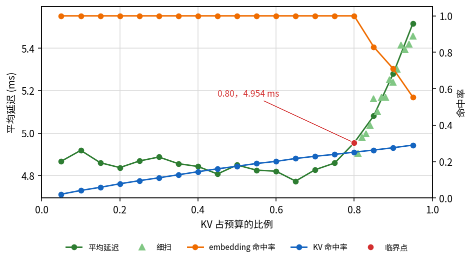
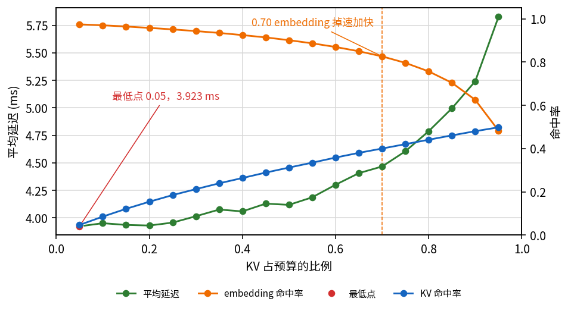
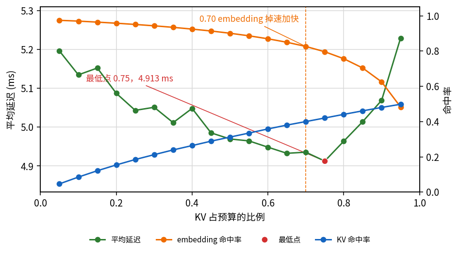

Total cache size: FlexKV 的 KV cache 和 GPU 上的 embedding cache 总量固定 16GiB。

Workload: KuaiRand-27K 前半段，候选 C = 100。用户按 Zipf α=0.5 抽成请求流，先预热 cache，再计时。

- **同流**：从 8000 个用户中按 Zipf α=0.5 有放回抽取 8000 次，his = 1024 （item 和 action 分别 1k）。warmup 和真实 benchmark 用同一个 seed、同一条请求序列。embedding 全命中需要 3.08 GiB，KV 全命中需要 **48.72 GiB**。
- **双流**：用户池换成全部合格用户（约 26500），his = 4096（item 和 action 分别 4k），26000 条请求。预热 seed=1，计时 seed=2，两条 Zipf 序列不一样。池子 unique video 约 1005 万，embedding 全中要 19.17 GiB。KV 全命中需要 **30.90 GiB**。

Model: `kuairand_1k_inference_ranking.gin`：N = 3，H = 4，d = 128，d_h = 512，s = 1024，t = 2048，c = 100。

Cache ratio: 0.05–0.95，步长 0.05。

# Overall

1. [KV 占主导](#一kv-占主导)：同流，embedding 走 CPU 参数表。延迟随 KV 比例下降，最低在最右。本节另补充双流、embedding CPU 回源、无额外 wait 基线：KV 命中率提高，但平均计时延迟在 3.844–3.911 ms 之间，未呈现明显的 KV 主导趋势。

  |           | 命中          | miss                                    | Lmiss − Lhit |
  | --------- | ----------- | --------------------------------------- | ------------ |
  | KV        | FlexKV      | 重算                                      | 同流 0.05→0.80 实测延迟降 0.30 ms |
  | embedding | GPU 1.3 µs  | 0.0325 µs/id（实测最大 miss 345 id = 0.011 ms） | 0.010 ms     |

2. [embedding 占主导](#二embedding-占主导)：同流 Redis，最低点在 embedding hit rate < 1 的临界点。双流 T=128 走 Redis，KV 不空等，两边命中仍在动，最低仍在最左。

  |           | 命中          | miss               | Lmiss − Lhit |
  | --------- | ----------- | ------------------ | ------------ |
  | KV        | FlexKV      | 重算                 | 远小于 Redis     |
  | embedding | GPU 1.3 µs  | Redis MGET 0.93 ms | 0.93 ms      |

3. [权衡实验](#三权衡实验)：embedding 全命中 19.17 GiB；KV 全命中 30.90 GiB。能打平是命中率变化和每条请求的 miss 损失一起作用。

  |           | 一条请求全 miss 的 wait | 实测命中率变化 | Latency 变化 |
  | --------- | ------------------ | ------- | -------------- |
  | KV        | 该请求 1.33 ms        | 0.047→0.498（Δh=0.45） | 1.33 × 0.45 = 0.60 ms  |
  | embedding | 0.410 µs/id（2976 id = 1.22 ms） | 0.975→0.483（miss 76→1538，Δh=0.49） | 0.410 µs × 1462 = 0.60 ms |

# 一、KV 占主导

同流，his = 1k。KV miss 在 GPU 上重算，命中从 FlexKV 读。embedding miss 走 CPU 参数表。

$$
\begin{aligned}
\Delta L_{\mathrm{emb}}(f)&=0.0325\ \mu\mathrm{s}\times\Delta m(f)
\end{aligned}
$$

扫到的 embedding miss 最大在 f=0.95，345 id，只有 0.011 ms。所以只要 embedding 还能盖住 3.08 GiB，延迟只跟 KV 走。

图的左轴是平均延迟，右轴是命中率。蓝线是 KV token 命中率。橙线是 embedding 命中率。

### Total Cache size = 16 GiB

KV 比例 ≤ 0.80 时，embedding cache ≥ 3.20 GiB，命中率是 1，延迟随 KV 增大往下走。0.85 / 0.90 / 0.95 时 embedding 命中掉到 0.830、0.710、0.555，仍然远小于 KV 那项，延迟继续降，最低在最右 **f=0.95，5.273 ms**。左端 5.614 ms。

# 二、embedding 占主导

同流，his = 1k。KV miss 仍是重算。embedding miss 进本机 Redis，一次请求一次 MGET：30 µs + 0.87 µs × m。

$$
\begin{aligned}
\Delta L_{\mathrm{emb}}(f)&=0.030\ \mathrm{ms}+0.87\ \mu\mathrm{s}\times\Delta m(f)
\end{aligned}
$$

一条请求 Redis 全 miss 0.93 ms。16 GiB 从 0.80 到 0.85，KV 命中只从 0.252 到 0.263；Redis 大约 136 id × 0.87 µs ≈ 0.12 ms。最低点因此在 embedding 还能全中的最后一格。

图的左轴是平均延迟，右轴是命中率。绿线是粗扫，浅绿三角是细扫。蓝线是 KV 命中率。橙线是 embedding 命中率。红点标在 embedding 还能全中的最后一格。

### Total Cache size = 16 GiB

KV 比例 ≤ 0.80 时 embedding cache ≥ 3.20 GiB，命中率是 1。0.05 到 0.80 平均延迟 4.773–4.954 ms，是波动。临界点在 **0.80**。之后：

- 0.80：命中率 1，miss 0
- 0.85：命中率 0.830，miss 约 136
- 0.90：命中率 0.710，miss 约 229
- 0.95：命中率 0.555，miss 约 345

粗扫从 0.80 的 4.954 ms 升到 0.95 的 5.515 ms。细扫 0.81→0.95 从 4.905 ms 升到 5.457 ms。

双流，KV 窗口 128。命中率和权衡实验同一条：橙线 0.975→0.483，蓝线 0.047→0.498。KV 不空等，只走真实重算。embedding miss 进本机 Redis。两边命中在动，乘完仍是 embedding 主导。

图的左轴是平均延迟，右轴是命中率。蓝线是 KV token 命中率。橙线是 embedding 命中率。红点是最低点。

### Total Cache size = 16 GiB（双流，T=128，Redis）

平均延迟 3.923–5.827 ms。最低在最左 **f=0.05，3.923 ms**。过 f≈0.70（embedding 约 4.8 GiB）橙线掉速加快，0.70 到 0.95 从 4.467 ms 升到 5.827 ms。

# 三、权衡实验

双流。His = 4096，embedding 查整段历史加候选，全命中 cache size = 19.17 GiB。KV 全部命中 cache size = **30.90 GiB**。

权衡能出现，是 KV / embedding 的命中率变化，和每条请求的 miss 损失，两项共同作用：

$$
\Delta L=(L_{\mathrm{miss}}-L_{\mathrm{hit}})\times\Delta h
$$

和前面两种不一样：本次测试 embedding hit rate 从 0.975 降到 0.483，KV hit rate 从 0.047 升到 0.498，两边同时在动；一条请求全 miss 的 wait 也接近（KV 1.33 ms，embedding 1.22 ms）。

$$
\begin{aligned}
\Delta L_{\mathrm{kv}}(f)&=1.33\,\Delta h_{\mathrm{req}}(f)\ \mathrm{ms}\\
\Delta L_{\mathrm{emb}}(f)&=0.410\ \mu\mathrm{s}\times\Delta m(f)
\end{aligned}
$$

0.05→0.95：KV Δh=0.45，embedding Δh=0.49（miss 76→1538）。两项乘完，两边累计 wait 都是 **0.60 ms**，方向相反。每加 0.05 KV 比例，KV 大约省 0.03–0.05 ms，embedding 从 0.005 ms 涨到 0.17 ms。第一类只有 KV 这项在动；第二类 embedding 的 \(L_{\mathrm{miss}}-L_{\mathrm{hit}}\) 大一个数量级。这里两项都在，而且乘完差不多。

图的左轴是平均延迟，右轴是命中率。蓝线是 KV token 命中率。橙线是 embedding 命中率。红点是这一段实测最低点。

### Total Cache size = 16 GiB

平均延迟 4.913–5.229 ms。这一段最低点在 **f=0.75，4.913 ms** （存在embedding cache 和 kv cache 竞争的关系），左端 5.196 ms，右端 5.229 ms。相对左端低 0.283 ms。此外 embedding hit rate 从 cache ratio > 0.7 (embedding cache size = 4.8 GiB) 开始 miss rate 变化率增大。
