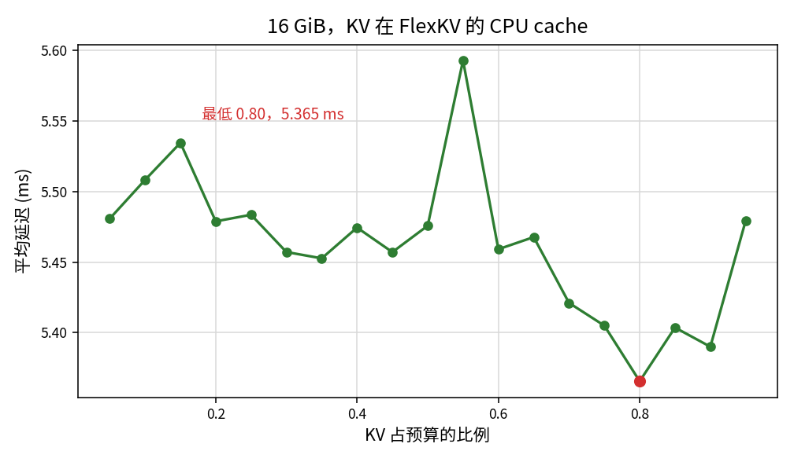
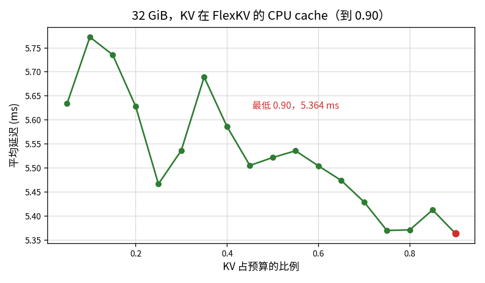
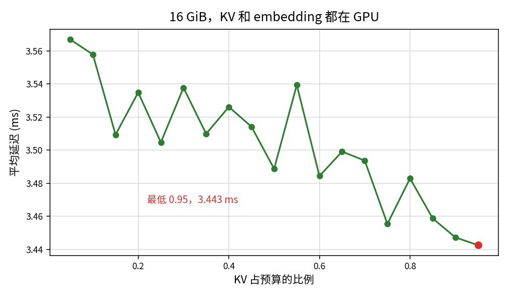
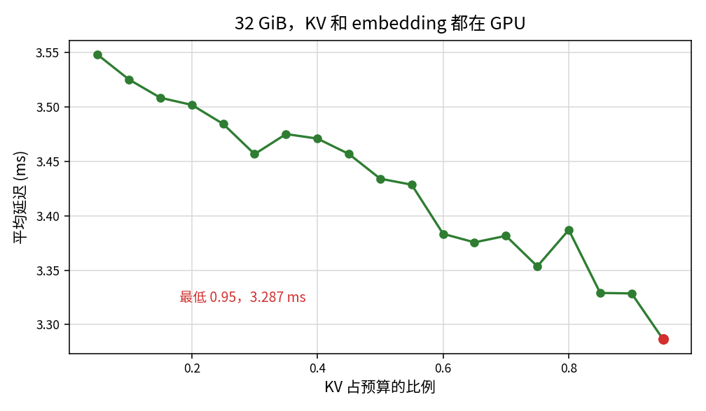
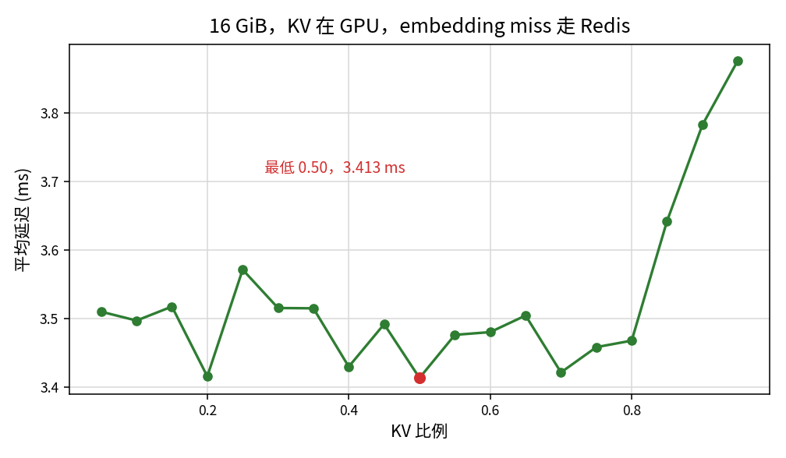
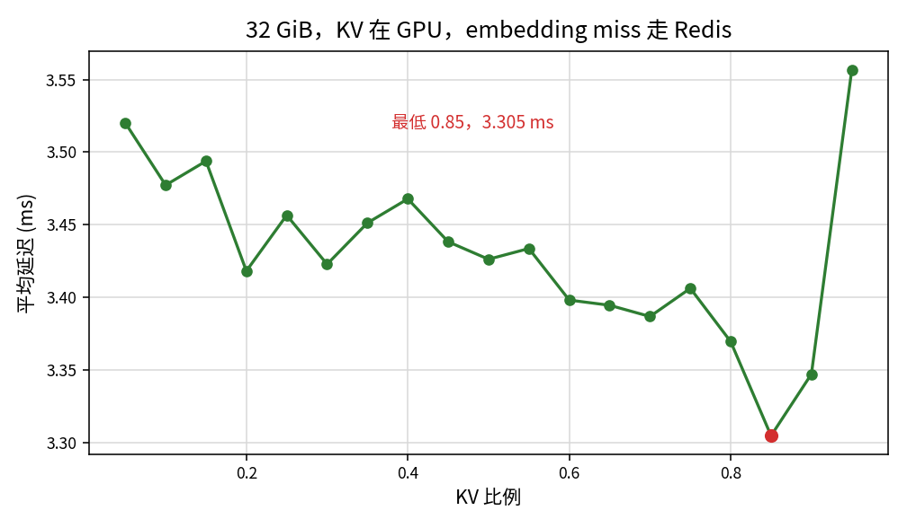
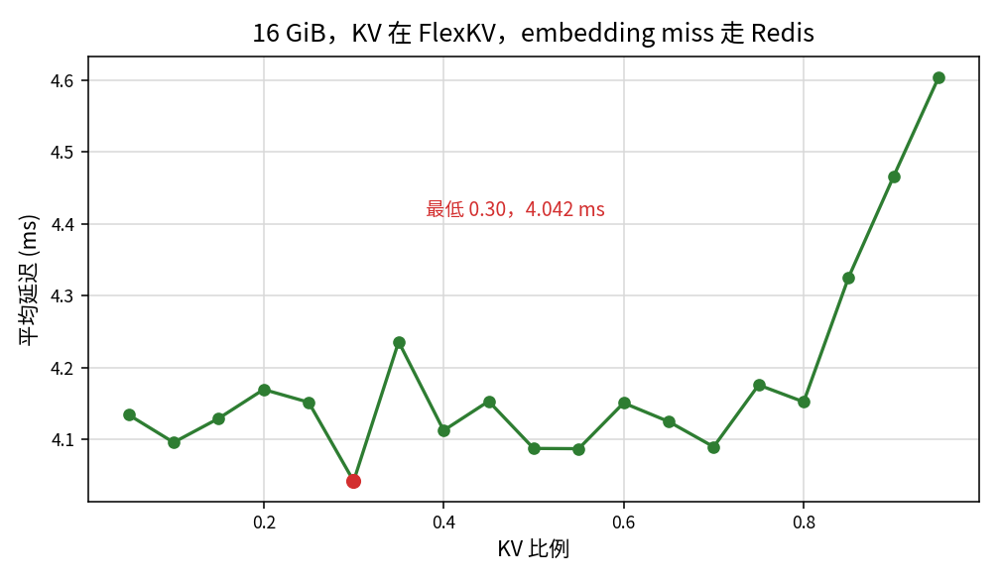
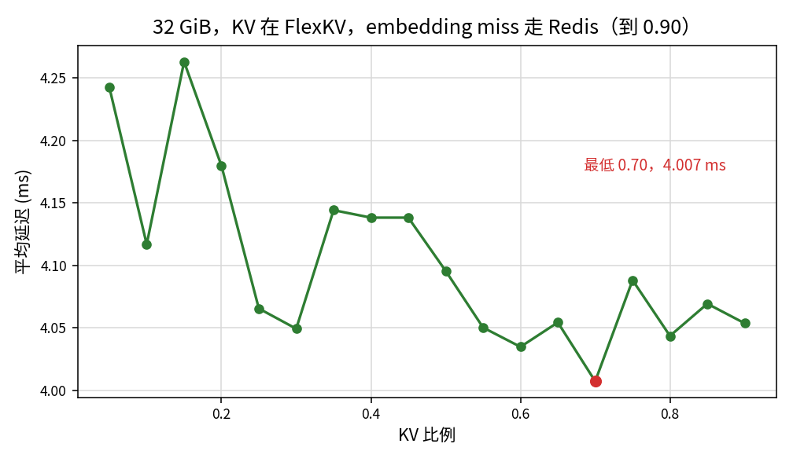

# Performance Impact of Cache Size Ratio

## 理论分析

总容量记为 $M$，分给 KV 和 embedding：

$$
S_k + S_e = M
$$

### 当前模型中 data size

层数 N，head 数 H，head dim = d，hidden size = d_h。历史有 s 个 item。item 和 action 各是一个 token，历史 token 数 t=2s。KV 是 bf16，每个数 2 字节。embedding 是 fp32，每个数 4 字节。候选个数是 c。

一个 token 的 K 和 V，全部层加在一起：

$$
b_{\mathrm{tok}}=N\cdot 2\cdot H\cdot d\cdot 2
$$

一个用户整段历史的 KV：

$$
\text{KV data size}=B_{\mathrm{kv}}=t\cdot b_{\mathrm{tok}}=8NHds
$$

一个 video id 的向量：

$$
\text{embedding size}=B_{\mathrm{emb}}=4d_h
$$

`kuairand_1k_inference_ranking.gin`：N = 3，H = 4，d = 128，d_h = 512，s = 1024，t = 2048，c = 100。

|                | 数值     |
| -------------- | ------ |
| 每 token KV     | 6144 B |
| KV data size   | 12 MiB |
| embedding size | 2048 B |

### RTX PRO 6000 的理论性能

GPU 是 RTX PRO 6000 Blackwell Server Edition，显存 GDDR7。

| 峰值            | 数值         |
| ------------- | ---------- |
| HBM           | 1597 GB/s  |
| BF16 Peak     | 500 TFLOPS |
| PCIe Gen5 x16 | 63.0 GB/s  |

### KV Cache 相关 latency 计算

#### 1. 全部重算

每一层对 t 个历史 token 做 uvqk 投影和输出投影，再做因果 attention。uvqk 把 d_h 投到 4Hd，输出投影把 Hd 投回 d_h，乘加各计 2 次。因果 attention 的 query-key 对有 t(t+1)/2 个，QK 和 AV 各是长度 d 的乘加，再乘 head 数，因此 FLOPS：

$$
F_{\mathrm{hist}}=N\Big(10\,t\,d_h\,H\,d+2\,H\,d\,t(t+1)\Big)
$$

Bytes:

$$
b_{\mathrm{layer}}=2\big(5Hd\,d_h+2t\,d_h+5t\,Hd\big)
$$

| 项            | 字节         | 一层       |
| ------------ | ---------- | -------- |
| uvqk 权重      | $8Hdd_h$   | 2 MiB    |
| 输出投影权重       | $2Hdd_h$   | 0.5 MiB  |
| 输入激活         | $2td_h$    | 2 MiB    |
| uvqk 输出      | $8tHd$     | 8 MiB    |
| attention 输出 | $2tHd$     | 2 MiB    |
| 投影输出         | $2td_h$    | 2 MiB    |
| 一层合计         | blayer     | 16.5 MiB |
| 三层           | N · blayer | 49.5 MiB |

一层：

| 步骤           | 数据量      | 计算量         | 搬运      | 计算      | Latency  |
| ------------ | -------- | ----------- | ------- | ------- | -------- |
| uvqk         | 12 MiB   | 4.295 GFLOP | 7.88 µs | 8.59 µs | 8.59 µs  |
| 因果 attention | 8 MiB    | 4.297 GFLOP | 5.25 µs | 8.59 µs | 8.59 µs  |
| 输出投影         | 4.5 MiB  | 1.074 GFLOP | 2.95 µs | 2.15 µs | 2.95 µs  |
| 一层           | 24.5 MiB | 9.666 GFLOP |         |         | 20.14 µs |
| 三层           | 73.5 MiB | 29.0 GFLOP  |         |         | 0.060 ms |

#### 2. 全部从 GPU 中获取

历史 token 不再做 uvqk，也不再做历史内部的因果 attention。K、V 从显存读出来，候选 query 还要和整段历史做 attention。推理时候选只保留 item，query 数是 c，历史 key 数是 t=2s。每个候选看全部历史，候选之间再做因果。QK 和 AV 各按 2d 计：

$$
F_{\mathrm{hit}}=N\cdot 2Hd\big(2ct+c(c+1)\big)
$$

|                     | 数据量    | 计算量         | 搬运      | 计算      | Latency |
| ------------------- | ------ | ----------- | ------- | ------- | ------- |
| 读 KV 并做候选 attention | 12 MiB | 1.289 GFLOP | 7.88 µs | 2.58 µs | 7.88 µs |

#### 3. 全部从 CPU 中获取

先经 PCIe 把 KV 搬回 GPU，再做上面那次 attention。

|                | PCIe     | attention 的 Latency | 合计       |
| -------------- | -------- | ------------------- | -------- |
| 搬回并做 attention | 0.200 ms | 7.88 µs             | 0.208 ms |

#### 4. 当命中率为 h 时，latency

一条请求的历史要么整段在 cache 里，要么整段重算。请求命中率是 h，则

$$
L_{\mathrm{kv}}(h)=h\,L_{\mathrm{kv}}+(1-h)\,L^{\mathrm{miss}}_{\mathrm{kv}}
$$

##### a. 在 CPU 中命中

Lkv 取上一节的合计：

$$
L_{\mathrm{kv,CPU}}(h)=0.060+0.148\,h\ \mathrm{ms}
$$

##### b. 在 GPU 中命中

$$
L_{\mathrm{kv,GPU}}(h)=0.060-0.052\,h\ \mathrm{ms}
$$

### embedding 相关 latency 计算

一条向量没有计算量。命中从显存读 Bemb，未命中走 PCIe 读同一份字节。

| 步骤     | 数据量    | 计算量 | 搬运        | 计算  | Latency   |
| ------ | ------ | --- | --------- | --- | --------- |
| GPU 命中 | 2048 B | 0   | 1.28 ns   | 0   | 1.28 ns   |
| PCIe   | 2048 B | 0   | 0.0325 µs | 0   | 0.0325 µs |

第 $t$ 条请求要查的 id 个数跟着 KV 命中变。KV 命中只查 $c$ 个候选，KV 未命中还要查这段历史的 $a_u$ 个 id：

$$
N_t=(1-I_t)\,a_{u_t}+c
$$

$I_t$ 是这条请求的 KV 命中指示，取值 0 或 1。embedding cache 的命中率是 $e$。一条请求的取数时间是

$$
L_{\mathrm{emb},t}=N_t\Big(e\,L_{\mathrm{embedding}}+(1-e)\,L^{\mathrm{miss}}_{\mathrm{embedding}}\Big)
$$

GPU 命中是纳秒，平均时拿掉。8000 条上，KV 未命中请求的平均历史 id 数是 $\bar a$，每条请求的 embedding miss 次数是

$$
n(h,e)=(1-h)\,\bar a\,(1-e)+c\,(1-e)
$$

### cache size 和 命中率的关系

KV cache 的索引是 `user_id`。每个用户只记一个长度：这段历史从第 0 个 token 起连续存了多少。lookup 查到这个用户，就返回那个长度；查不到，就返回 0。淘汰也按用户，把这个用户的页和长度一起删掉。

3 层这次回放里，每个用户的历史长度是固定的，最多 1024 个 item，再次被抽到时不会变长。所以一条请求只有两个状态：用户还在 cache 里，命中长度等于整段历史；用户已经被淘汰，命中长度是 0。前缀命中要历史在两次请求之间变长才会出现。

整段流量的命中率：

$$
h(S_k)=\frac{1}{T}\sum_t I_t,\qquad I_t\in\{0,1\}
$$

使用 LRU 进行evict 时，cache 先留更近的那些用户：

$$
I_t=\mathbf{1}\{\delta_t+b_{u_t}\le S_k\}
$$

$b_u$ 是用户 $u$ 的 KV 大小。出现过的用户集合记为 $W$，总量

$$
B=\sum_{u\in W}b_u
$$

$S_k\ge B$ 时第二遍不再淘汰任何人，$h=1$。$S_k<B$ 时，只出现一次的请求全部未命中：两次访问隔着整圈流量，中间的用户总量就是 $B$。

3 层这条流量 $B=48.72\mathrm{GiB}$。8000 条里有 2655 条只出现一次。48.00 GiB 时 cache 里已经有 4393 个用户，这个空位仍会在第二遍里转圈，2655 条全部未命中，$h=0.66$。容量加到 48.72 GiB，空位消失，$h$ 跳到 1。所以

$$
h(S_k)=\frac{T_+}{T}\,h_+(S_k)\quad(S_k<B),\qquad h(S_k)=1\quad(S_k\ge B)
$$

T+ 是重复用户的请求数，h+ 是这些请求的命中率。按这个规则做的 LRU 回放和实测逐点一致，差在 0.001 以内。

embedding cache 的索引是 video id，命中率记为 $e(S_e)$。预热和计时走同一串请求。$S_e\ge E$ 时，计时这一遍要查的 id 都已经在 cache 里，$e=1$。3 层的 $E=3.08\mathrm{GiB}$。$S_e<E$ 之后 $e$ 随 $S_e$ 下降，$n$ 上升。

### latency 与 cache size 的关系

一条请求的时间把历史 KV 和 embedding 加在一起。对 8000 条平均：

$$
\bar L(S_k,S_e)=h(S_k)\,L_{\mathrm{kv}}+(1-h(S_k))\,L^{\mathrm{miss}}_{\mathrm{kv}}+n\big(h(S_k),e(S_e)\big)\,L^{\mathrm{miss}}_{\mathrm{embedding}}
$$

$S_e\ge E$ 时 $n=0$，延迟只剩 $S_k$ 上的命中率：

$$
\bar L(S_k)=h(S_k)\,L_{\mathrm{kv}}+(1-h(S_k))\,L^{\mathrm{miss}}_{\mathrm{kv}}
$$

GPU 上 $h$ 随 $S_k$ 升高，这段平均下降，直到 $S_k=B$、$h=1$，之后不再变。CPU 上按上一节的屋顶，$h$ 升高会让这段平均变长，因为 0.208 ms 的命中长于 0.060 ms 的重算。$S_e$ 降到 $E$ 以下之后，$n$ 变大，两项叠在一起。

### latency 与 cache ratio 的关系

比例是 KV 分到的那一份：

$$
f=\frac{S_k}{M},\qquad S_e=(1-f)M,\qquad 0\le f\le 1
$$

$$
\bar L(f)=\bar L\big(fM,\ (1-f)M\big)
$$

$f$ 变大时 $dh/df\ge 0$、$de/df\le 0$。embedding 还盖得住是 $e=1$，对应 $f\le 1-\frac{E}{M}$。KV 已经全中是 $h=1$，对应 $f\ge\frac{B}{M}$。两份工作集同时装下是 $B+E\le M$；这时在 $\frac{B}{M}\le f\le 1-\frac{E}{M}$ 上有 $h=1$ 且 $e=1$。

### 求导 并计算极点

$$
\frac{d\bar L}{df}=(L_{\mathrm{kv}}-L^{\mathrm{miss}}_{\mathrm{kv}})\frac{dh}{df}+L^{\mathrm{miss}}_{\mathrm{embedding}}\frac{dn}{df}
$$

$e=1$ 时 $n=0$，第二项是 0。延迟对比例的斜率只剩命中率这一项。把

$$
L(h)=L^{\mathrm{miss}}_{\mathrm{kv}}+(L_{\mathrm{kv}}-L^{\mathrm{miss}}_{\mathrm{kv}})\,h
$$

代进去，对 $h$ 的斜率就是 Lkv − Lmisskv。上一节的 $L(h)$ 给出：

| 路径       | Lkv − Lmisskv                   | $e=1$ 且 $h$ 还在增加时 |
| -------- | ------------------------------- | ----------------- |
| KV 在 GPU | 7.88 µs − 0.060 ms = −0.052 ms  | $f$ 增大，延迟下降       |
| KV 在 CPU | 0.208 ms − 0.060 ms = +0.148 ms | $f$ 增大，延迟上升       |

极点由这四样决定：

- Lkv − Lmisskv：命中比重算便宜还是贵，来自上面的 $L(h)$。
- $B$：$f=B/M$ 时 $h$ 到 1，$dh/df$ 变为 0。
- $E$：$f=1-E/M$ 时 $e$ 离开 1。过了这条线 $dn/df>0$，第二项变正。$n$ 怎么涨还取决于 $\bar a$、$c$，以及 $e$ 随 $S_e$ 下降的速度。
- Lmissembedding：一次 embedding miss 有多贵。它决定第二项能不能盖过第一项。

极点 $f^{*}$ 是导数为零的比例，$S_k^{*}=f^{*}M$。令 $d\bar L/df=0$：

$$
\left.\frac{dh}{df}\right|_{f^{*}}=\frac{L^{\mathrm{miss}}_{\mathrm{embedding}}}{L^{\mathrm{miss}}_{\mathrm{kv}}-L_{\mathrm{kv}}}\left.\frac{dn}{df}\right|_{f^{*}}
$$

$h$ 在 $f=B/M$ 饱和，$e$ 在 $f=1-E/M$ 离开 1。用这两个阈值把上式收成：

$$
f^{*}=
\begin{cases}
f_{\min}, & L_{\mathrm{kv}}>L^{\mathrm{miss}}_{\mathrm{kv}}\\[4pt]
\left[\dfrac{B}{M},\,1-\dfrac{E}{M}\right], & L_{\mathrm{kv}}<L^{\mathrm{miss}}_{\mathrm{kv}},\ M\ge B+E\\[8pt]
1-\dfrac{E}{M}, & L_{\mathrm{kv}}<L^{\mathrm{miss}}_{\mathrm{kv}},\ M<B+E
\end{cases}
$$

第三行用的是边界上第二项已经不小于第一项。若 $n$ 涨得更慢，$f^{*}$ 改由第一式在 $f>1-E/M$ 的根决定。$f_{\min}$ 是扫描里最小的 KV 比例。

Lkv < Lmisskv 时，左端 $f$ 增大延迟下降，极点在延迟重新变长的地方。

- $M<B+E$ 时，$e$ 先于 $h=1$ 掉下来。若一过 $f=1-E/M$ 第二项就大于第一项，极点就在这条边界上：

$$
f^{*}=1-\frac{E}{M},\qquad S_k^{*}=M-E
$$

若第二项涨得慢，极点在边界右侧，位置由上面的抵消式和 $e(S_e)$ 一起决定。

- $M\ge B+E$ 时，$h$ 先到 1。从 $f=B/M$ 到 $f=1-E/M$，$h=1$ 且 $e=1$，两项导数都是 0，极点是这一整段。右端仍然是 $f=1-E/M$。

Lkv > Lmisskv 时，第一项在 $h$ 增加的过程中已经是正的，$f$ 越大延迟越长。极点在 $f$ 最小的那一端，位置不再依赖 $E$。

### 带入一个真实的case 进行计算

case 用 3 层配置和这份 KuaiRand。Bkv = 12 MiB，Bemb = 2048 B，$B=48.72\mathrm{GiB}$，$E=3.08\mathrm{GiB}$。重算屋顶 0.060 ms，GPU 命中 7.88 µs，CPU 命中 0.208 ms。

同一台机器上，embedding 还盖得住、请求尚未全中的点，命中率每增加 1，平均延迟下降 0.515 ms，残差 0.020 ms。这个 0.515 ms 大约是屋顶上 0.052 ms 的十倍，历史 KV 以外的 kernel 也算在里面。用它替换 Lmisskv 之后，GPU 上 $h$ 每增加 1 仍下降，下降量改成 0.515 ms。CPU 上 $0.515-0.208=0.307\mathrm{ms}$，命中变成省时间，屋顶里那一项 $+0.148\mathrm{ms}$ 的方向被反过来。FlexKV 的曲线在命中率上升时仍往下走，跟的是这个实测差。

Redis 的极点位置不用改。90 次 miss 的取数已经大于这一小步里 0.515 ms 能省下的时间，导数仍在 $S_e=E$ 变号。

| 总容量    | $B/M$     | $1-E/M$ | KV 在 GPU、Redis 的极点                      |
| ------ | --------- | ------- | --------------------------------------- |
| 16 GiB | 48.72 装不下 | 0.81    | $f=0.81$，KV 12.9 GiB，embedding 3.08 GiB |
| 32 GiB | 48.72 装不下 | 0.90    | $f=0.90$，KV 28.9 GiB，embedding 3.08 GiB |
| 64 GiB | 0.76      | 0.95    | $f$ 从 0.76 到 0.95 都是底                   |

16 GiB 的 GPU + Redis 在 0.80 和 0.85 之间转头，0.80 到 0.95 升高 0.408 ms。32 GiB 在 0.90 和 0.95 之间转头，升高 0.210 ms。64 GiB 从 0.80 到 0.95 命中率已经是 1，平均延迟停在 2.924–2.934 ms，embedding 最少还有 3.20 GiB，仍高于 3.08 GiB，平底和这四格重合。

CPU 参数表把 Lmissembedding 换成 0.026 µs/id。同样 90 次 miss 只值 0.002 ms，盖不住 0.515 ms 这一档的命中收益。导数要到 embedding 只剩大约 0.4 GiB 才变成正的。16 GiB 的最低在 $f\approx 0.96$–$0.97$，32 GiB 在 $f\approx 0.99$，比把预算全部给 KV 只低 0.004–0.006 ms，小于残差 0.020 ms，也落在 0.05 一格的网格右端之外。测到的 16 GiB 和 32 GiB 因此一路降到 0.95。

## 实际测试

Cache total size 按 16 GiB、32 GiB、64 GiB 三档，每一档再按比例分给 KV cache 和 embedding cache。

### 数据

KuaiRand-27K 前半段里每个用户的序列。序列末尾 100 个 video 当作候选，再往前的部分当作历史。历史不足 32 个 video 的用户跳过；按文件顺序留下 8000 个合格用户，历史长于 1024 的截到 1024。请求用 Zipf（α = 0.5，seed = 1）从这 8000 人里抽 8000 次。

### 模型

`kuairand_1k_inference_ranking.gin`，3 层 HSTU、4 个 head、hidden 512、kv channels 128、bf16，batch size 1。

### KV 在 CPU cache + embedding cache 在 GPU 上，miss 走 CPU 参数表

#### Total Cache size = 16 GiB

整段平均延迟落在 5.365–5.593 ms，跨度 0.228 ms。0.05 到 0.50 在 5.45–5.54 ms 里来回，token 命中率从 0.021 升到 0.175。0.20、0.35、0.45 这些落差是 0.004–0.02 ms，和相邻点的抖动一样。

#### Total Cache size = 32 GiB

最低点在目前的右端 0.90，**5.364 ms**。0.90 的 embedding cache 是 3.20 GiB，仍盖住 3.08 GiB 的 id，命中率还在升。

### KV + embedding cache 在 GPU 上，miss 走 CPU 参数表

#### Total Cache size = 16 GiB

红点是最低的 0.95。

平均延迟从 0.05 的 3.567 ms 降到 0.95 的 **3.443 ms**，跨度 0.124 ms。最低点在右端。0.95 的 embedding cache 是 0.80 GiB，已经低于 3.08 GiB，平均延迟仍在降。token 命中率从 0.020 升到 0.291。和理论一致：这一档还没走到那个很浅的最低点。

#### Total Cache size = 32 GiB

红点是最低的 0.95。

平均延迟从 0.05 的 3.548 ms 降到 0.95 的 **3.287 ms**，跨度 0.261 ms。0.80 抬到 3.387 ms，0.85 和 0.90 都是 3.329 ms，0.95 再降到 3.287 ms。0.95 的 embedding cache 是 1.60 GiB，是这一档唯一低于 3.08 GiB 的点，它仍是最低点。token 命中率从 0.040 升到 0.480。32 GiB 装不下 48.72 GiB 的 KV 流。

#### Total Cache size = 64 GiB

红点是最低的 0.95。0.80 起命中率到 1。

平均延迟从 0.05 的 3.547 ms 降到 0.75 的 3.246 ms。0.75 的 KV 是 48.00 GiB，比 48.72 GiB 少 0.72 GiB，token 命中率 0.661。0.80 的 KV 是 51.20 GiB，命中率到 1.000，平均延迟降到 2.928 ms。
0.80 到 0.95 落在 2.924–2.934 ms。数字上的最低点是 0.95 的 **2.924 ms**，和 0.80 差 0.004 ms。0.95 的 embedding cache 是 3.20 GiB，仍高于这条流的 3.08 GiB，所以这段平台是 KV 已经饱和、embedding 也还够，还没有开始测 miss。理论里的平底是 f 从 0.76 到 0.95，和这四格重合。

embedding 还盖得住、请求全命中尚未到 1 的点上，命中率每增加 1，平均延迟下降 0.515 ms，残差 0.020 ms。按这条直线外推的底是 3.068 ms。h = 1 之后测到的是 2.929 ms 一带：最后装进 cache 的历史更长，省下的时间多于 0.515 ms。

### KV + embedding cache 在 GPU 上，embedding miss 走 Redis

#### Total Cache size = 16 GiB

红点是图里最低的 0.50。0.80 这一格 embedding cache 是 3.20 GiB，还盖住 3.08 GiB。0.85 降到 2.40 GiB，取数开始落到 Redis。理论凹点在 f = 0.81，就在 0.80 和 0.85 之间。

0.05 到 0.80 的平均延迟在 3.413–3.571 ms 里来回，跨度 0.158 ms。数字上最低的是 0.50 的 3.413 ms，0.20 是 3.416 ms，都落在这段起伏里，不是边界上的那个最低点。0.80 是 3.468 ms。从这里往右：

| KV 比例 | 平均延迟  | token 命中率 | embedding |
| ----- | ----- | --------- | --------- |
| 0.80  | 3.468 | 0.252     | 3.20 GiB  |
| 0.85  | 3.642 | 0.263     | 2.40 GiB  |
| 0.90  | 3.782 | 0.276     | 1.60 GiB  |
| 0.95  | 3.876 | 0.290     | 0.80 GiB  |

0.80 到 0.95 升高 **0.408 ms**。命中率仍从 0.252 升到 0.290。转头的位置和 $f=0.81$ 重合。

#### Total Cache size = 32 GiB

红点是图里最低的 0.85。0.90 这一格 embedding cache 是 3.20 GiB，还盖住 3.08 GiB。0.95 降到 1.60 GiB。理论凹点在 $f=0.90$。

0.05 到 0.90 的平均延迟从 3.520 ms 降到 3.347 ms。数字上最低的是 0.85 的 3.305 ms，embedding cache 还有 4.80 GiB，落在这段下降里。从 0.90 到 0.95：

| KV 比例 | 平均延迟  | token 命中率 | embedding |
| ----- | ----- | --------- | --------- |
| 0.90  | 3.347 | 0.463     | 3.20 GiB  |
| 0.95  | 3.557 | 0.482     | 1.60 GiB  |

0.90 到 0.95 升高 **0.210 ms**。命中率仍从 0.463 升到 0.482。转头的位置和 $S_k=M-E$ 重合。

### KV 在 CPU cache + embedding cache 在 GPU 上，embedding miss 走 Redis

#### Total Cache size = 16 GiB

红点是图里最低的 0.30。图从 0.05 开始。机器与上面两张 GPU Redis 图相同，毫秒可以比。

0.05 到 0.80 的平均延迟在 4.042–4.236 ms。0.80 是 4.153 ms，embedding cache 3.20 GiB。右边：

| KV 比例 | 平均延迟  | token 命中率 | embedding |
| ----- | ----- | --------- | --------- |
| 0.80  | 4.153 | 0.255     | 3.20 GiB  |
| 0.85  | 4.326 | 0.267     | 2.40 GiB  |
| 0.90  | 4.466 | 0.279     | 1.60 GiB  |
| 0.95  | 4.604 | 0.294     | 0.80 GiB  |

0.80 到 0.95 升高 **0.451 ms**。同一条流量、KV 放在 GPU 时，这四格从 3.468 ms 升到 3.876 ms。两边都在 0.80 之后转头。FlexKV 这一档整体比 GPU 上的 KV 高大约 0.7 ms。

#### Total Cache size = 32 GiB

写到 0.90。0.00 没有放进图。0.95 共享内存不足，没有写入，作业还停在这一格。0.90 的 embedding cache 是 3.20 GiB，仍高于 3.08 GiB，转头要到下一格才会出现。

0.05 到 0.90 的平均延迟在 4.007–4.263 ms。数字上最低的是 0.70 的 4.007 ms，命中率 0.389，embedding cache 9.60 GiB，落在这段起伏里。0.90 是 4.054 ms，命中率 0.464。和同一台机器上 KV 放在 GPU 的 32 GiB 比，0.90 的命中率同是 0.46，FlexKV 这一档高大约 0.7 ms。理论边界在 $f=0.90$ 的右侧，0.95 还没有点。